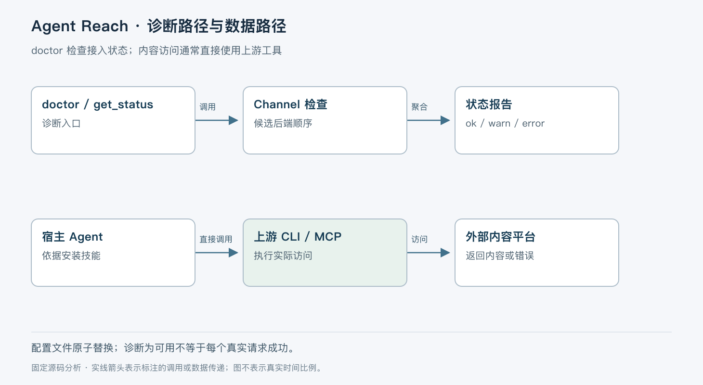

# Agent Reach 的接入与体检边界

> 版本依据：仓库 [Panniantong/Agent-Reach](https://github.com/Panniantong/Agent-Reach)；默认分支 `main`；完整 commit `a19a171fa980a0785849596492e0af4db800c82f`。源码读取日期：2026-10-05（Asia/Shanghai）。榜单快照：2026-10-04 23:56。

本文面向有工程经验的开发者。实现事实以这一源码快照为准；“本文归纳”是分析判断，“说明性示例”未实际执行。许可证以仓库 [LICENSE](https://github.com/Panniantong/Agent-Reach/blob/a19a171fa980a0785849596492e0af4db800c82f/LICENSE) 为依据。没有提供额外参考文档。


Agent Reach 将不同互联网平台的工具安装、凭据配置和可用性检查集中起来，再通过技能告诉 Agent 怎样调用上游工具。它解决的主要问题是接入维护成本：不同网站需要不同 CLI、登录态、浏览器桥接或网络环境，单纯给模型一个 HTTP 工具并不能覆盖这些差异。

当前 `AgentReach` 核心类只提供 `doctor()` 与 `doctor_report()`；源码明确要求实际阅读、搜索直接调用上游工具。因此，它不能被描述为把所有内容请求统一代理、清洗并自动重试的抓取网关。MCP 服务也只注册 `get_status`，没有通用 `read` 或 `search` 工具。[核心接口](https://github.com/Panniantong/Agent-Reach/blob/a19a171fa980a0785849596492e0af4db800c82f/agent_reach/core.py)、[MCP 注册](https://github.com/Panniantong/Agent-Reach/blob/a19a171fa980a0785849596492e0af4db800c82f/agent_reach/integrations/mcp_server.py#L28-L78)。

本快照版本 `1.5.0`，采用 MIT 许可，包元数据标记 Beta，要求 Python 3.10 或更高。官方关于免费、平台覆盖和无感切换的概括，应结合每个渠道的实现与上游条件理解；本次没有验证所有平台真实可达，更没有验证外部服务长期价格。[包定义](https://github.com/Panniantong/Agent-Reach/blob/a19a171fa980a0785849596492e0af4db800c82f/pyproject.toml)、[官方说明](https://github.com/Panniantong/Agent-Reach/blob/a19a171fa980a0785849596492e0af4db800c82f/README.md)。

## 控制配置与实际访问分两条路径

本文按职责归纳如下。

| 对象 | 作用 | 不代表什么 |
| --- | --- | --- |
| CLI | 安装、配置、体检、技能注册等入口 | 不统一代理所有平台读取请求 |
| `Config` | 保存本地设置并读取环境变量 | 不自动把所有凭据注入任意上游进程 |
| `Channel` | 描述平台、候选后端和检查逻辑 | `can_handle()` 本身不会抓取内容 |
| `ProbeResult` | 区分缺失、损坏、超时及错误 | 命令能执行不等于账号已登录 |
| 技能及 references | 指导 Agent 使用上游命令 | 不是强制流量路由器 |



`Channel.ordered_backends()` 复制候选列表，根据 `<channel>_backend` 配置把匹配项移到前面；未知覆盖值不删除其他可用候选。`active_backend` 是检查结果，不能直接理解为后续每条上游请求都会通过该实例。[渠道合同](https://github.com/Panniantong/Agent-Reach/blob/a19a171fa980a0785849596492e0af4db800c82f/agent_reach/channels/base.py#L1-L78)。

## 一次 doctor 请求怎样产生报告

以“Agent 需要查阅 Reddit 讨论”为说明性示例。用户先运行 doctor 判断本机具备什么条件。CLI 解析 `doctor` 与 `--json`，核心检查进入 `check_all(config)`，顺序遍历渠道并调用各自 `check()`。每个结果包含状态、显示名称、消息、tier、候选后端及 active backend。[CLI 入口](https://github.com/Panniantong/Agent-Reach/blob/a19a171fa980a0785849596492e0af4db800c82f/agent_reach/cli.py#L68-L186)、[报告构造](https://github.com/Panniantong/Agent-Reach/blob/a19a171fa980a0785849596492e0af4db800c82f/agent_reach/doctor.py#L16-L43)。

某个渠道抛异常时，doctor 记录该渠道 `error` 并继续，不让一次异常摧毁全报告。它还把返回结果的 active backend 清空，防止复用渠道对象时泄漏上一轮成功状态。最后统一清洗消息中的 URL 凭据，再输出文本或 JSON。文本报告做 Rich 转义，这是呈现安全与凭据处理的边界，不是内容抓取管线。

这里的遍历是同步顺序执行。慢渠道会增加整次体检耗时；不能把不同平台描述为默认并发检测。`probe_command()` 的默认超时是 10 秒，重试默认 0；配置重试时只对暂时性 timeout/error 再试，missing/broken 立即返回，也没有指数退避。[探测实现](https://github.com/Panniantong/Agent-Reach/blob/a19a171fa980a0785849596492e0af4db800c82f/agent_reach/probe.py#L45-L129)。

## Reddit 为什么仍可能是 warn

`RedditChannel.check()` 检查候选后端，收集结果后优先选择 `ok`，其次 `warn`。但本快照对 OpenCLI 的桥接可连接状态仍返回 `warn`：doctor 没有实际执行 Reddit 平台命令，因此登录态和业务请求未证实。[Reddit 选择逻辑](https://github.com/Panniantong/Agent-Reach/blob/a19a171fa980a0785849596492e0af4db800c82f/agent_reach/channels/reddit.py#L38-L92)。

rdt-cli 路径只安全读取用户显式保存的 `credential.json`，检查 JSON 形状、cookie 字段和保存时间。它刻意不调用可能自动刷新浏览器 cookie 的 `rdt status`；即使发现 cookie，也返回未实时验证。7 天阈值是诊断规则，不是对远端会话过期时间的保证。[凭据检查](https://github.com/Panniantong/Agent-Reach/blob/a19a171fa980a0785849596492e0af4db800c82f/agent_reach/channels/reddit.py#L94-L149)。

因此示例的下一步不是把 warn 改写为“Reddit 已可用”，而是在用户已有授权的登录态下，按技能调用上游工具读取一个已知帖子，再确认业务响应。实际访问失败的重试、限流、分页和会话更新由上游工具及 Agent 决定，本项目的 doctor 不自动完成这些动作。

## 配置持久化怎样避免半写文件

`Config` 读取 `~/.agent-reach/config.yaml`，普通读取不创建目录。显式只读模式禁止 save，MCP 服务使用该模式。保存时先拒绝符号链接路径，再在同目录创建临时文件，写 YAML、flush、fsync，最后 `os.replace()` 替换目标，并尝试同步目录；Unix 文件权限限定为 owner 读写。[配置生命周期](https://github.com/Panniantong/Agent-Reach/blob/a19a171fa980a0785849596492e0af4db800c82f/agent_reach/config.py#L45-L158)。

这降低了凭据意外泄漏与中断后半文件的风险，但没有为多个进程的 read-modify-write 加锁。两个配置进程从旧快照分别修改不同键，仍可能最后一次写入覆盖前一次修改。原子替换保证的是单次文件可见性，不是多写者合并。

探测也不只用 `which()`。旧虚拟环境的 shim 仍存在，但 shebang 指向的解释器已被删除时，执行会失败；`_run_once()` 把这种情况归类为 broken 并提供重装提示。stdout/stderr 采用 UTF-8 解码并替换非法字符，使不同系统上的诊断输出更稳定。[探测错误分类](https://github.com/Panniantong/Agent-Reach/blob/a19a171fa980a0785849596492e0af4db800c82f/agent_reach/probe.py#L91-L129)。

## 什么场景适合采用

适合已使用命令行 Agent、希望集中维护多平台接入条件的个人或团队。技能与体检层让后端替换更容易，代价是业务接口、输出格式和运行可靠性仍分散在上游工具中。

不适合直接当作多租户数据采集服务。统一身份隔离、任务队列、请求审计、远端限流和结果持久化，需要另行建设。对于“能否读取目标页面”，应分别记录工具已安装、桥接已连接、账号已登录和业务请求已成功，避免一个绿色标记掩盖不同条件。

## 源码地图与最小验证

建议顺序是 `core.py` 确认责任边界，`channels/base.py` 理解渠道协议，`doctor.py` 追踪聚合，再看 `channels/reddit.py` 与 `probe.py` 的异常分类，最后读 `config.py` 的持久化。相关测试包括 `tests/test_doctor.py`、`tests/test_probe.py`、`tests/test_doctor_credential_boundaries.py` 与 `tests/test_private_file_writes.py`，分别检查聚合、执行失败、凭据读取边界与文件写入。

依据官方 CLI 与源码整理，以下命令未在本次环境运行。先在隔离目录建立 Python 环境，避免安装指令改动日常宿主；使用本快照源码安装基础包，不运行自动安装平台工具的命令：

```bash
uv venv .venv
uv pip install --python .venv/bin/python .
uv run --no-project --python .venv/bin/python -m agent_reach.cli doctor --json
```

预期得到逐渠道状态，而不是所有渠道都成功。doctor 会执行部分上游探测，实际行为受本机已安装工具影响。本次未运行这些命令、未读取用户 cookie、未请求平台内容；源码核验能够确认分类和持久化逻辑，不能确认用户环境的可用性。

Agent Reach 的工程价值是把接入问题拆成能诊断的条件。真正采用时，保留这些条件的区分比追求“一个命令通所有平台”的表面一致性更可靠。
