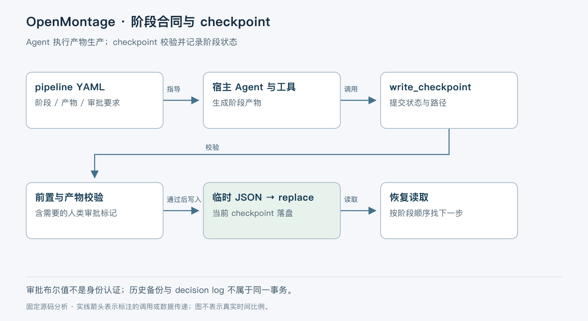

# OpenMontage 的阶段产物与恢复机制

> 版本依据：仓库 [calesthio/OpenMontage](https://github.com/calesthio/OpenMontage)；默认分支 `main`；完整 commit `9327439db69021ab4b0e2776729bf3b58fdb5a87`。源码读取日期：2026-10-05（Asia/Shanghai）。榜单快照：2026-10-04 23:56。

本文面向有工程经验的开发者。实现事实以这一源码快照为准；“本文归纳”是分析判断，“说明性示例”未实际执行。许可证以仓库 [LICENSE](https://github.com/calesthio/OpenMontage/blob/9327439db69021ab4b0e2776729bf3b58fdb5a87/LICENSE) 为依据。没有提供额外参考文档。


OpenMontage 把视频生产组织成可检查的阶段：创意、场景计划、素材、剪辑决定和最终合成等。它解决的是长链路生产中“前一阶段承诺了什么、当前产物是否足够继续、失败后从哪里恢复”的问题。直接让 Agent 连续调用视频工具，容易得到一批文件，却说不清它们与已确认方案的关系。

仓库采用 AGPL-3.0 许可，包含技能、YAML pipeline 定义、JSON schema、工具与生产看板相关实现。外部模型和媒体服务有各自账号与计费条件，仓库开源不等于所有生产方式免费。本文以明确标为 beta 的 `documentary-montage` 为例，聚焦阶段控制与 checkpoint，不把作者展示的视频成本当成本次实测。[项目说明](https://github.com/calesthio/OpenMontage/blob/9327439db69021ab4b0e2776729bf3b58fdb5a87/README.md)、[流水线定义](https://github.com/calesthio/OpenMontage/blob/9327439db69021ab4b0e2776729bf3b58fdb5a87/pipeline_defs/documentary-montage.yaml#L1-L42)。

## 流水线描述工作合同，Agent 负责执行

`pipeline_loader.py` 读取 YAML 并按 schema 校验，`get_stage_order()` 返回声明顺序；`get_stage_skill()` 找到阶段技能，`get_stage_human_approval_default()` 提供审批默认值。`load_pipeline_readonly()` 缓存 manifest，约定单次运行内只读，因此修改 YAML 不应被想当然地当成热更新。[加载与查询](https://github.com/calesthio/OpenMontage/blob/9327439db69021ab4b0e2776729bf3b58fdb5a87/lib/pipeline_loader.py#L24-L180)。

documentary-montage 的阶段从 `idea` 到 `scene_plan`、`assets`、`edit`、`compose`。每个阶段声明所需产物、可用工具、产出和审查要点。例如素材阶段要求每个场景槽位有一个片段，并保留 provider、原始 URL 和 license 等来源信息；这是该流水线的生产合同，不是 Python loader 自动完成检索和视觉筛选。[阶段合同](https://github.com/calesthio/OpenMontage/blob/9327439db69021ab4b0e2776729bf3b58fdb5a87/pipeline_defs/documentary-montage.yaml#L44-L152)。



本文把技能执行与 checkpoint 验证分开画。Agent 可能调用素材或生成服务，checkpoint 只记录结果及阶段状态；写入 checkpoint 不会替调用方执行视频生成，也不能撤销已经发生的远端花费。

## 一次阶段提交怎样变成可恢复状态

说明性示例是制作一段城市历史短片。先用 `init_project()` 建立项目目录、资源子目录和 `project.json`。初始化重复执行会保留原 `created_at` 并合并身份字段，但这不是整个视频生成操作的幂等保证。[项目初始化](https://github.com/calesthio/OpenMontage/blob/9327439db69021ab4b0e2776729bf3b58fdb5a87/lib/checkpoint.py#L197-L250)。

Agent 完成 idea 后，调用 `write_checkpoint()`，传入项目、阶段、状态和 artifacts。函数必要时从 project marker 补回 pipeline 与 style 信息，避免调用方漏传身份时绕过规则；检查阶段是否合法，再从 manifest 确定审批要求。调用方可以加严 gate，不能用 `human_approval_required=False` 降低 manifest 的要求。[写入入口及 gate](https://github.com/calesthio/OpenMontage/blob/9327439db69021ab4b0e2776729bf3b58fdb5a87/lib/checkpoint.py#L421-L498)。

若本阶段要求批准而尚未批准，就不能写 `completed`。正常路径先写 `awaiting_human`，展示产物，获得明确确认后再写 `completed` 且 `human_approved=True`。这里的布尔字段记录调用方提供的批准事实，函数本身不认证“谁点了批准”；不能把它描述为抗恶意调用方的权限系统。

## 前置阶段与产物都有检查

进入 `awaiting_human` 或 `completed` 前，`_enforce_stage_prerequisites()` 按 manifest 顺序读取所有前置 checkpoint，校验 JSON、项目身份、pipeline、阶段名、完成状态以及必要批准。缺失、损坏或身份不符均不能当作完成。`in_progress` 和失败记录允许写入，以便排障和恢复，不会被前置 gate 阻断。[前置检查](https://github.com/calesthio/OpenMontage/blob/9327439db69021ab4b0e2776729bf3b58fdb5a87/lib/checkpoint.py#L283-L350)。

随后校验 canonical artifacts：例如 `scene_plan` 阶段到达完成或待确认状态时，必须包含对应产物，并按已知 schema 检查其对象结构。非 canonical 扩展阶段没有被强行映射成一个不存在的产物名，但仍需满足 checkpoint schema。[产物与记录校验](https://github.com/calesthio/OpenMontage/blob/9327439db69021ab4b0e2776729bf3b58fdb5a87/lib/checkpoint.py#L106-L190)。

测试明确覆盖“跳过缺失前置阶段”“伪造完成但缺少批准”“损坏的前置 checkpoint”等情形。这些测试支持 gate 逻辑存在，不证明生成的视频叙事、画质或来源授权已合格。[前置条件回归](https://github.com/calesthio/OpenMontage/blob/9327439db69021ab4b0e2776729bf3b58fdb5a87/tests/lib/test_checkpoint_prerequisites.py)。

## 落盘点与恢复顺序

校验通过后，`write_checkpoint()` 先序列化到同目录 `.json.tmp`，保存被替代版本的历史，再 `os.replace()` 原子替换当前 checkpoint。若序列化失败，当前文件不会先被截断；新文件替换成功后，读取方才能看到该版本。[checkpoint 落盘](https://github.com/calesthio/OpenMontage/blob/9327439db69021ab4b0e2776729bf3b58fdb5a87/lib/checkpoint.py#L535-L566)。

历史归档采用复制，失败时只记录 warning；`in_progress` 心跳不会反复归档。因此 history 是尽力保存的阶段版本记录，不是不可丢失的事务日志。checkpoint 与附属 decision log 也不是同一个原子事务，后者单独合并并写入。[历史策略](https://github.com/calesthio/OpenMontage/blob/9327439db69021ab4b0e2776729bf3b58fdb5a87/lib/checkpoint.py#L353-L391)、[决策日志](https://github.com/calesthio/OpenMontage/blob/9327439db69021ab4b0e2776729bf3b58fdb5a87/lib/checkpoint.py#L399-L418)。

恢复有两个容易混淆的入口：`get_latest_checkpoint()` 按文件修改时间找最近记录；`get_next_stage()` 则按流水线顺序找第一个尚未 completed 的阶段。最近修改的阶段不一定是下一项执行目标；重做较早阶段后，必须结合产物依赖判断下游结果是否仍适用，不能只靠 mtime 继续。[恢复读取](https://github.com/calesthio/OpenMontage/blob/9327439db69021ab4b0e2776729bf3b58fdb5a87/lib/checkpoint.py#L569-L633)。

## 并发与失败仍需执行方管理

这里没有为同一阶段的多个写者提供锁或乐观版本比较，而且临时文件名固定。并行 Agent 同时写一个阶段可能相互覆盖或争用临时文件。建议把同阶段提交集中到协调者，或在外层增加执行隔离；“原子替换”不等于“并发安全的工作流数据库”。这一限制来自写入实现的静态分析，本次没有构造并发故障。

manifest 缺失与损坏的退化路径也不同。明确未知的 pipeline 在 gate 解析处抛错；其他加载异常会记录 warning 并回退调用方标志。阶段顺序函数又保留 canonical fallback。生产集成应把这些 warning 纳入诊断，不能以为所有配置错误都一致 fail-closed。[审批策略加载](https://github.com/calesthio/OpenMontage/blob/9327439db69021ab4b0e2776729bf3b58fdb5a87/lib/checkpoint.py#L253-L280)、[阶段回退](https://github.com/calesthio/OpenMontage/blob/9327439db69021ab4b0e2776729bf3b58fdb5a87/lib/checkpoint.py#L41-L66)。

外部视频 API 超时后是否已生成、重试是否重复计费，以及生成文件是否完整，要由具体 provider 工具确认。checkpoint 不包含能对所有服务统一去重的机制。恢复到“素材阶段未完成”不代表可以无条件重复发送所有素材请求。

## 工程取舍与适用场景

文件化产物和 schema 让各阶段容易检查、分享与追踪，也便于现有编程 Agent 使用。成本是协调与一致性责任更多落在执行方：同阶段多写者、远端任务恢复、审批真实性都需要明确约定。技能中的预算和修订上限也必须核查执行入口是否实际遵循，不能只因为 YAML 有字段就宣称硬限额生效。

适合有人参与审查、愿意保存阶段产物的视频生产流程。不适合直接当成具备强隔离与严格账单控制的多租户自动生产后端。项目允许丰富的工具与自定义脚本，灵活性对应更广的运行环境与依赖管理负担。

## 阅读地图与最小验证

先读所选 `pipeline_defs/*.yaml`，确定真实阶段，再读 `lib/pipeline_loader.py`，随后完整追踪 `lib/checkpoint.py:write_checkpoint`、`_enforce_stage_prerequisites` 和 `get_next_stage`。最后对照 `tests/lib/test_checkpoint_prerequisites.py`，理解哪些异常已被测试覆盖。

推荐先跑 checkpoint 合同测试，不连接生成服务。以下命令依据仓库依赖与测试布局整理，未在本次环境运行；前置条件是隔离的 uv 环境，并先审阅依赖安装内容：

```bash
uv venv .venv
uv pip install --python .venv/bin/python -r requirements-dev.txt
uv run --no-project --python .venv/bin/python -m pytest tests/lib/test_checkpoint_prerequisites.py
```

预期缺失前置阶段和未批准的前置阶段被拒绝。随后在临时项目里验证 `awaiting_human → completed` 和中断后 `get_next_stage()`，再考虑接入真实媒体工具。本次没有渲染视频、调用收费 API 或发布内容。

OpenMontage 的关键选择，是用阶段产物让复杂创作变得可检查。它的恢复能力应理解为围绕文件和合同继续工作，而不是自动重放一条没有副作用的流水线。
