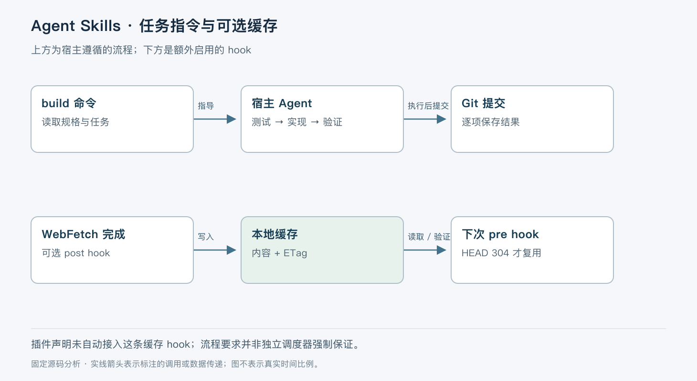

# Agent Skills 如何组织工程工作流

> 版本依据：仓库 [addyosmani/agent-skills](https://github.com/addyosmani/agent-skills)；默认分支 `main`；完整 commit `1401c8b8030e023baeebb31781a6653fe8e93026`。源码读取日期：2026-10-05（Asia/Shanghai）。榜单快照：2026-10-04 23:56。

本文面向有工程经验的开发者。实现事实以这一源码快照为准；“本文归纳”是分析判断，“说明性示例”未实际执行。许可证以仓库 [LICENSE](https://github.com/addyosmani/agent-skills/blob/1401c8b8030e023baeebb31781a6653fe8e93026/LICENSE) 为依据。没有提供额外参考文档。


`addyosmani/agent-skills` 将规格、计划、增量实现、测试与审查等工程习惯封装为技能与命令。它解决的不是模型缺少一个新的工具，而是长任务中步骤容易脱节：要求写了但实现漏掉，测试做了却没有复查构建，完成状态与 Git 中的实际改动不一致。

本快照版本为 `0.6.12`，采用 MIT 许可。项目的主要执行载体是 Markdown 指令；宿主负责读取技能、调用工具与推进任务。`production-grade` 是作者对技能定位的描述，不能据此推出运行时可靠性或某个模型的服从率。[插件清单](https://github.com/addyosmani/agent-skills/blob/1401c8b8030e023baeebb31781a6653fe8e93026/.claude-plugin/plugin.json)、[项目说明](https://github.com/addyosmani/agent-skills/blob/1401c8b8030e023baeebb31781a6653fe8e93026/README.md)。

## 命令把多个技能组合成一次任务

`commands/build.toml` 让宿主同时采用 `incremental-implementation` 与 `test-driven-development`。默认 `/build` 只完成下一项；`/build auto` 则在计划确认后沿依赖顺序执行全部任务。命令文件给出操作顺序，没有在后台启动一个独立的 workflow engine。[构建命令](https://github.com/addyosmani/agent-skills/blob/1401c8b8030e023baeebb31781a6653fe8e93026/commands/build.toml)。

本文按职责区分四类资产：命令确定本次工作方式，技能描述工程方法，规格与计划文件保存任务状态，hook 脚本补充特定工具行为。安装方式影响哪些资产真的进入宿主。只安装单个技能可能不包含仓库根部共享 `references/`；README 已说明这项可移植性缺口。[单技能安装限制](https://github.com/addyosmani/agent-skills/blob/1401c8b8030e023baeebb31781a6653fe8e93026/README.md#L55-L69)。



图中的顺序是指令规定的工作流。是否实际逐步执行，应通过工具记录、测试输出和提交记录验证；不能把图当成不可跳过的程序状态机。

## 从规格到逐项提交

说明性示例：为一个 API 增加分页，规格已明确默认页大小、无效参数响应与兼容行为。`/build auto` 首先只在 `SPEC.md`、`docs/SPEC.md` 或 `spec/` 寻找规格，README 不算规格；缺失时要求停止，而不是自行补全需求。[前置条件](https://github.com/addyosmani/agent-skills/blob/1401c8b8030e023baeebb31781a6653fe8e93026/commands/build.toml#L27-L37)。

随后检查 `git status --porcelain`。预期规划文件之外存在未提交修改时，需要决定如何处理，防止每项提交混入用户改动。没有 `tasks/plan.md` 时先生成计划，展示全计划并等待明确肯定，再执行每项任务。顺序采用显式依赖；没有依赖则按计划顺序。

每项任务的工作流是读验收条件、读取相关源码、写失败测试、最小实现、回归测试、构建、提交、更新状态。遇到无法解决的测试失败、规格歧义或高风险不可逆操作时停止。用户解决后重新调用命令，从待完成项继续。[任务循环与中止条件](https://github.com/addyosmani/agent-skills/blob/1401c8b8030e023baeebb31781a6653fe8e93026/commands/build.toml#L10-L52)。

所谓“恢复”依赖规格、任务文件与 Git 这些可读资产，不是保存模型进程栈。若工具已成功提交而状态文件未标记完成，下一次必须对照 Git 核实；简单重做整项可能产生重复改动。项目没有为这些文本步骤提供一个跨 Git、文件写入与模型调用的分布式事务。

## 原生技能路由与启动注入不能混为一谈

`hooks/session-start.sh` 能把 `using-agent-skills` 作为 `additionalContext` 输出；但文件明确注明插件默认没有接上这个脚本，因为 Claude Code、Codex 已按描述路由技能，再注入另一套路由会重复。缺少 `jq` 或元技能时，脚本返回说明而以成功状态退出，保留单独使用技能的可能性。[启动脚本](https://github.com/addyosmani/agent-skills/blob/1401c8b8030e023baeebb31781a6653fe8e93026/hooks/session-start.sh#L1-L38)。

这说明“仓库存在 hook”不等于“安装插件后 hook 自动执行”。部署到具体宿主时，要看实际 manifest 和宿主配置。对本文选用快照，`.claude-plugin/plugin.json` 注册 commands、skills 与实验性 evals，不能凭文件名推断所有 hooks 都启用。

## 源码驱动开发有一条真实缓存链路

`source-driven-development` 要求先确定依赖版本，再读取权威资料，最后让实现与来源对应。仓库另有可选 WebFetch 缓存 hook，值得单独分析，因为它包含真正的条件请求和文件持久化。[技能流程](https://github.com/addyosmani/agent-skills/blob/1401c8b8030e023baeebb31781a6653fe8e93026/skills/source-driven-development/SKILL.md#L33-L108)。

`sdd-cache-post.sh` 从工具响应提取文本，并发起 HEAD 获取最终响应的 ETag 或 Last-Modified。缓存键是 URL 的 SHA-256 前 32 个十六进制字符；prompt 作为元数据保存，不参与键。若服务器不提供校验器，脚本删除该 URL 的旧缓存。满足条件才把 URL、prompt、正文和校验器写入临时文件，再 `mv` 到最终位置。[写入链路](https://github.com/addyosmani/agent-skills/blob/1401c8b8030e023baeebb31781a6653fe8e93026/hooks/sdd-cache-post.sh)。

下次 `sdd-cache-pre.sh` 读取缓存，附带 `If-None-Match` 或 `If-Modified-Since` 发起最长 5 秒的 HEAD 请求。只有 HTTP 304 且缓存正文非空时才复用；其他状态、网络失败或缺少依赖都放行正常 WebFetch。命中时用 stderr 提供缓存内容，并以退出码 2 阻止原工具执行，这是宿主 hook 的替代结果机制。[复用条件](https://github.com/addyosmani/agent-skills/blob/1401c8b8030e023baeebb31781a6653fe8e93026/hooks/sdd-cache-pre.sh#L18-L112)。

这个缓存有一个很重要的语义限制：WebFetch 保存的可能是经过模型按 prompt 处理的文本，URL 没变化并不代表旧 prompt 的摘录适合新问题。因此命中消息展示原 prompt，要求 Agent 判断是否覆盖本次角度。HTTP 304 只能确认远端资源未变，不能确认模型摘要完整，也不能验证网页内容可信。

并发方面，临时文件加 rename 避免读到半写 JSON，但没有按 URL 排队或去重；不同请求可同时抓取并最后写入。更细的竞态是工具读取内容与后续 HEAD 获取校验器之间源站发生变化，二者未必代表同一瞬间。这是依据两步请求顺序做出的风险归纳，不是本次复现的故障。

## 取舍与适用边界

工作流用文本表达，容易审查、修改和跨模型复用；代价是步骤的强制性取决于宿主与模型。要求“每项一个提交”有助于人工回退，却不能替代代码隔离或自动一致性检查。条件请求缓存减少重复读取，但增加 HEAD 延迟，也依赖服务器正确提供校验器。

适合已有版本控制、构建和测试设施，希望让 Agent 按统一工作方式推进的仓库。不适合把它当作具备严格调度、权限审批和故障恢复语义的平台。若必须保证测试失败绝不合并，应在 CI 与分支保护中落实；若必须隔离并发任务，应使用独立 checkout 或执行环境。

## 阅读地图与最小验证

| 顺序 | 入口 | 阅读问题 |
| --- | --- | --- |
| 1 | `.claude-plugin/plugin.json` | 实际注册了哪些资产？ |
| 2 | `commands/build.toml` | 自动模式的前置条件和停点在哪里？ |
| 3 | `skills/incremental-implementation/SKILL.md` | 怎样拆成可验证的增量？ |
| 4 | `hooks/session-start.sh` | 哪些宿主不应额外注入路由？ |
| 5 | `hooks/sdd-cache-pre.sh`、`hooks/sdd-cache-post.sh` | 缓存何时命中，存的究竟是什么？ |
| 6 | `hooks/sdd-cache-test.sh` | 测试如何模拟 HTTP 校验与缓存结果？ |

推荐在已有测试的小型临时 Git 仓库里只试一项变更。依据官方说明整理，以下命令未在本次环境运行：

```bash
claude --plugin-dir /path/to/agent-skills
```

先确认宿主发现了技能，准备一份明确规格，再调用 `/build`，核对失败测试、通过测试、构建和提交是否真实发生。不要把第一次验证直接设成部署任务。测试缓存则应另行审阅 `hooks/sdd-cache-test.sh`，在具备 Bash、jq、curl 与哈希工具的隔离环境运行，分别检查 304、非 304 和无校验器路径。

本次只做源码与测试静态检查，没有让该插件执行代码任务。项目最有价值的部分是把工程步骤变成可读、可讨论的协议；真正的强制约束仍需由开发工具链提供。
