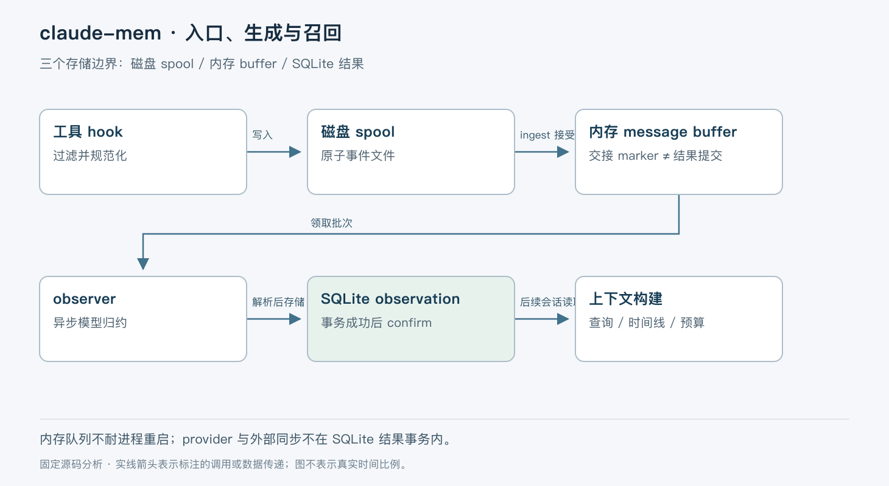

# claude-mem：从工具事件到可检索记忆，拆开三种持久化边界

> 版本依据：仓库 [thedotmack/claude-mem](https://github.com/thedotmack/claude-mem)；默认分支 `main`；完整 commit `bfc50259f64a4e0c9e81df849095683608e87ac8`。源码读取日期：2026-10-05（Asia/Shanghai）。榜单快照：2026-10-04 23:56。

本文面向有工程经验的开发者。实现事实以这一源码快照为准；“本文归纳”是分析判断，“说明性示例”未实际执行。许可证以仓库 [LICENSE](https://github.com/thedotmack/claude-mem/blob/bfc50259f64a4e0c9e81df849095683608e87ac8/LICENSE) 为依据。没有提供额外参考文档。


## 一、项目解决什么问题

claude-mem 为编码助手保留跨会话的工作记忆：收集工具使用等事件，通过 observer 提炼 observation 和 summary，再在之后的会话中检索或注入上下文。它不训练底层模型，也不能保证模型总结的每个事实都正确。它承担的是事件采集、记忆生成、存储和召回这一层。[项目说明](https://github.com/thedotmack/claude-mem/blob/bfc50259f64a4e0c9e81df849095683608e87ac8/README.md)

本文分析 13.29.0 固定源码，重点是 Claude Code 的本地 worker 路径。当前仓库同时有 server runtime 分支，不能把本地路径的数据库与故障处理概括为所有部署方式。最容易误读的地方是队列：当前 `SessionMessageBuffer` 在内存中维护待生成片段；与此同时，hook 入口有磁盘 spool，生成结果有 SQLite。它们是三种不同的状态。[入口分支](https://github.com/thedotmack/claude-mem/blob/bfc50259f64a4e0c9e81df849095683608e87ac8/src/cli/handlers/observation.ts#L73-L126)；[消息缓冲设计](https://github.com/thedotmack/claude-mem/blob/bfc50259f64a4e0c9e81df849095683608e87ac8/src/services/worker/SessionMessageBuffer.ts#L1-L110)

## 二、整体模型与对象关系

本文按职责归纳如下。hook handler 规范化工具事件并应用项目、子 Agent 等过滤；spool 暂存尚未交给 ingest 的事件；worker 按会话管理消息和 observer 生命周期；ResponseProcessor 检查模型输出并提交记忆；上下文构建器和搜索组件读取已生成内容。

`contentSessionId` 表示宿主会话，数据库内部会话 ID 和 observer 的 `memorySessionId` 另有用途。ResponseProcessor 会确保使用已注册的 memory session 身份写入，避免模型 SDK 后续返回新会话 ID 时破坏已有外键关系。不能把这几个 ID 当作可互换字符串。[身份确认与写入](https://github.com/thedotmack/claude-mem/blob/bfc50259f64a4e0c9e81df849095683608e87ac8/src/services/worker/agents/ResponseProcessor.ts#L585-L680)



图中箭头表示处理顺序；磁盘 spool、内存 buffer 和 SQLite 结果库分别标出。入口落盘不是 observation 已生成。

## 三、工具事件如何进入系统

说明性示例：助手读取一个配置文件，再修改超时参数。PostToolUse 触发 observation handler，带入工具名、输入、响应、cwd、会话及可选 `toolUseId`。handler 检查项目是否需要跟踪，也可能在任何 provider 调用前过滤子 Agent 事件。[handler](https://github.com/thedotmack/claude-mem/blob/bfc50259f64a4e0c9e81df849095683608e87ac8/src/cli/handlers/observation.ts#L18-L71)

本地路径调用 `spoolHookEvent` 后返回继续执行，避免等待 observer。spool 为每个事件使用独立文件，采用原子 JSON 写入；重投事件使用稳定文件身份，避免并发 hook 向同一个追加文件写出交错内容。文件按事件时间与文件名排序；单进程内的单调时间并不等价于跨进程全局因果顺序。[spool 结构](https://github.com/thedotmack/claude-mem/blob/bfc50259f64a4e0c9e81df849095683608e87ac8/src/shared/hook-spool.ts#L1-L31)

worker drain 把文件交给 ingest。在有 consumed markers 的配置下，ingest 在接受事件后、启动 provider 工作前调用 `markHandedOff()`，同步记录 SQLite marker；之后才删除 spool 文件。若删除前崩溃，重启会看到 marker，清理文件而不再次 ingest。[drain](https://github.com/thedotmack/claude-mem/blob/bfc50259f64a4e0c9e81df849095683608e87ac8/src/shared/hook-spool.ts#L246-L340)

这个机制限制重复交接，不能扩展成“记忆生成端到端恰好一次”。源码也明确处理 marker 写入失败：记录错误但继续 generator，此时崩溃后存在重复 ingest 风险。已接受的片段随后可能只在内存中；交接完成不是语义结果已经持久化。损坏文件会隔离，超过重试窗口的未接收事件会移入 expired，而不是无限重试。[错误与过期处理](https://github.com/thedotmack/claude-mem/blob/bfc50259f64a4e0c9e81df849095683608e87ac8/src/shared/hook-spool.ts#L295-L340)；[过期实现](https://github.com/thedotmack/claude-mem/blob/bfc50259f64a4e0c9e81df849095683608e87ac8/src/shared/hook-spool.ts#L363-L409)

## 四、为什么当前版本使用内存消息缓冲

`SessionMessageBuffer` 保存 `claimed`、`parked`、入队时间等状态。worker 按会话领取消息，成功后 confirm 删除；可重试故障则 resetClaimed。`toolUseId` 去重限定在当前 worker 生命周期与会话，不能据此声称跨重启去重。[缓冲实现](https://github.com/thedotmack/claude-mem/blob/bfc50259f64a4e0c9e81df849095683608e87ac8/src/services/worker/SessionMessageBuffer.ts)

源码注释解释了取舍：这些片段要在持续变化的 observer 对话状态中归约；单独持久化旧队列、却没有恢复相同 reducer 状态，容易造成重复 observation 和重试风暴。当前把 transcript JSONL 视为恢复来源，而非启动时自动扫旧 pending 队列继续发送。这是代码中的设计依据；本次没有实际演练 transcript 恢复，不能保证任意宿主日志缺失时仍能无损恢复。

因此，要分开问两个问题：事件是否交给 worker，和结果是否写入记忆库。进程崩溃可能发生在两者之间。为了限制付费请求，耗尽预算的消息可以 parked，保留在 RAM 中但不继续当作 pending 发送；它不是永久保存的死信队列。[同一缓冲实现](https://github.com/thedotmack/claude-mem/blob/bfc50259f64a4e0c9e81df849095683608e87ac8/src/services/worker/SessionMessageBuffer.ts)

## 五、模型回答何时成为记忆

ResponseProcessor 先解析 observer XML。额度、认证、传输错误会恢复所领取批次的待处理状态并中止当前 generator；上下文溢出则走重建 observer 对话的路径。普通非 XML 回答并非无限重试：对于有待处理批次的情况，首次在新 generation 中再试，同一批次再次拒绝会记录错误并丢弃，防止阻塞后续工作。[错误分类](https://github.com/thedotmack/claude-mem/blob/bfc50259f64a4e0c9e81df849095683608e87ac8/src/services/worker/agents/ResponseProcessor.ts#L430-L580)

合法输出还要经过文件证据清理和空标题过滤。工具输入中实际涉及的文件证据用于修正 observation 与 summary，而不是无条件相信模型列出的路径。随后 `storeObservations` 把 observation 与相关 summary 写入 SQLite 事务。[证据与调用](https://github.com/thedotmack/claude-mem/blob/bfc50259f64a4e0c9e81df849095683608e87ac8/src/services/worker/agents/ResponseProcessor.ts#L611-L678)；[事务写入](https://github.com/thedotmack/claude-mem/blob/bfc50259f64a4e0c9e81df849095683608e87ac8/src/services/sqlite/SessionStore.ts#L3723-L3861)

数据库用 session 与内容 hash 限制重复插入；启用相应 dedup 时，还会按规范化标题查找跨会话 canonical observation 并更新其重复出现信息。这是有条件的归并机制，不能保证不同措辞的相同事实必然合并，也可能使标题规范化策略影响记忆粒度。[去重分支](https://github.com/thedotmack/claude-mem/blob/bfc50259f64a4e0c9e81df849095683608e87ac8/src/services/sqlite/SessionStore.ts#L3743-L3780)

成功存储后立即 confirm 消息，再做遥测、同步和广播等副作用。这样后续集成失败不会让已写入批次被整个重放。代价是这些后续动作与 SQLite 提交不是同一个事务；“界面已显示”“外部索引已同步”和“主库已提交”不应视为同一时刻。[确认顺序](https://github.com/thedotmack/claude-mem/blob/bfc50259f64a4e0c9e81df849095683608e87ac8/src/services/worker/agents/ResponseProcessor.ts#L658-L700)

## 六、下次会话如何读到结果

ContextBuilder 依据项目读取 observation、summary，编排时间线，再按上下文预算裁剪和渲染。它读取的是生成后的记忆，不是把全部原始工具输出重新塞进模型。代码还会呈现 observer 或同步健康状态，避免记忆缺失被误解为没有历史工作。[构建器](https://github.com/thedotmack/claude-mem/blob/bfc50259f64a4e0c9e81df849095683608e87ac8/src/services/context/ContextBuilder.ts)；[预算处理](https://github.com/thedotmack/claude-mem/blob/bfc50259f64a4e0c9e81df849095683608e87ac8/src/services/context/ContextBudget.ts)

压缩与预算使跨会话召回可用，但也会丢失细节、受到生成延迟影响。修改文件后立刻启动新会话，不一定已经读到这次修改的 observation。需要精确事实时仍应回到源码、原始 transcript 或具体工具结果核实，而不是把摘要当作审计原件。

## 七、设计取舍与适用场景

| 机制 | 能力 | 边界 |
|---|---|---|
| hook 异步采集与磁盘 spool | 降低主会话等待，容忍 worker 暂不可用 | 交接与生成完成分离 |
| 内存归约队列 | 控制活跃会话重试与重复生成 | 进程崩溃后需依赖其他恢复来源 |
| XML 解析加证据修正 | 约束可落库记忆的结构和文件关联 | 不构成事实真实性证明 |
| SQLite 事务与内容去重 | 保留可查询的生成结果 | 不覆盖所有外部同步副作用 |
| 上下文预算 | 限制注入量 | 历史内容可能被省略 |

适合长周期编码项目的工作线索与决策回顾。不适合直接充当无损审计系统，也不能替代业务数据库。对资料敏感的项目，应按实际 runtime、provider 和跟踪过滤配置评估数据流；本地 SQLite 不等于整个生成过程完全离线。

## 八、源码阅读与最小验证

建议依次读 [observationHandler](https://github.com/thedotmack/claude-mem/blob/bfc50259f64a4e0c9e81df849095683608e87ac8/src/cli/handlers/observation.ts)、[HookSpool](https://github.com/thedotmack/claude-mem/blob/bfc50259f64a4e0c9e81df849095683608e87ac8/src/shared/hook-spool.ts)、[SessionMessageBuffer](https://github.com/thedotmack/claude-mem/blob/bfc50259f64a4e0c9e81df849095683608e87ac8/src/services/worker/SessionMessageBuffer.ts)、[ResponseProcessor](https://github.com/thedotmack/claude-mem/blob/bfc50259f64a4e0c9e81df849095683608e87ac8/src/services/worker/agents/ResponseProcessor.ts)、[SessionStore](https://github.com/thedotmack/claude-mem/blob/bfc50259f64a4e0c9e81df849095683608e87ac8/src/services/sqlite/SessionStore.ts)、[ContextBuilder](https://github.com/thedotmack/claude-mem/blob/bfc50259f64a4e0c9e81df849095683608e87ac8/src/services/context/ContextBuilder.ts)。分别回答：过滤发生在哪里、交接何时确认、消息是否耐重启、模型错误是否重试、主库何时提交、召回如何裁剪。

依据官方安装说明整理，以下命令未在本次环境运行，会安装插件；marketplace 默认跟随其当前版本，安装后应检查版本是否与本文 13.29.0 对齐：

```text
/plugin marketplace add thedotmack/claude-mem
/plugin install claude-mem
```

在无敏感数据的临时项目，确认本地 worker runtime 和 provider 配置后，让宿主读取一个说明文件，再结束并重开会话。分别检查事件采集、observer 生成结果及新会话上下文，不能只看安装成功。预期可观察到生成与召回的时间差；若 provider 不可达，应从健康提示和错误分类辨别原因。这些步骤可能调用付费模型，本次未执行。

本次没有实际验证 worker 崩溃、server runtime、向量索引或跨宿主恢复。它们的部署兼容性与恢复完整性需要额外实验；本文对本地路径的状态边界不依赖这些实验结果。

## 结语

claude-mem 的工程重点是把“捕获事件”“生成记忆”“召回记忆”拆开处理。理解这三步的确认与丢失边界，比知道它使用哪一种模型或向量库更有助于判断是否适合自己的工作流。
