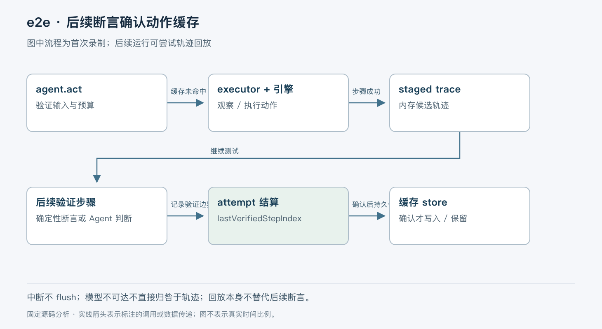

# e2e：用后续断言约束 Agent 动作回放

> 版本依据：仓库 [tester-army/e2e](https://github.com/tester-army/e2e)；默认分支 `main`；完整 commit `f99e80ebc04f8194f967244198783db871390e06`。源码读取日期：2026-10-05（Asia/Shanghai）。榜单快照：2026-10-04 23:56。

本文面向有工程经验的开发者。实现事实以这一源码快照为准；“本文归纳”是分析判断，“说明性示例”未实际执行。许可证以仓库 [LICENSE](https://github.com/tester-army/e2e/blob/f99e80ebc04f8194f967244198783db871390e06/LICENSE) 为依据。没有提供额外参考文档。


## 一、项目定位与核心问题

e2e 把自然语言操作和确定性断言放进同一个端到端测试。开发者可以让 Agent 完成一段难以稳定描述的界面操作，再用定位器检查结果。它的关键设计不是把每次测试都交给模型，而是记录已被验证的操作，后续优先回放。浏览器操作由 Playwright 引擎承担，移动端通过 agent-device；模型不直接替代测试运行器。[项目说明](https://github.com/tester-army/e2e/blob/f99e80ebc04f8194f967244198783db871390e06/README.md#L11-L52)

简单地缓存模型回答不能解决这个问题：一次“点击成功”不代表业务状态正确，页面变化后旧坐标也不再可靠。e2e 缓存的是带上下文与目标描述的动作轨迹，并要求后续验证步骤为轨迹提供可信依据。当前 SDK 为 0.17.0，官方明确说明仍在走向 1.0，次版本间 API 和配置可能变化；不能据此推定生产兼容性承诺。[成熟度说明](https://github.com/tester-army/e2e/blob/f99e80ebc04f8194f967244198783db871390e06/README.md#L78-L83)

## 二、整体模型：测试运行器拥有控制权

本文按职责归纳为四部分：运行器管理测试与重试；Agent dispatch 管理一次步骤；executor 决定下一步；引擎实际观察和操作应用。executor 可以替换，但预算、记录和结果分类仍由 harness 控制。

一次 `agent.act()` 使用四个协作者：`StepAccounting` 管时间与调用预算，`ObservationFeed` 管观察，`ActionDispatcher` 管动作，`StepTraceSession` 管缓存读写决策。它们不是四个独立 Agent。观察和动作共用 `OperationQueue`，按调用顺序运行，避免同一轮批量调用对已经失效的屏幕解析多个目标。[dispatch 实现](https://github.com/tester-army/e2e/blob/f99e80ebc04f8194f967244198783db871390e06/packages/e2e/src/agent/act.ts#L1-L16)；[队列接线](https://github.com/tester-army/e2e/blob/f99e80ebc04f8194f967244198783db871390e06/packages/e2e/src/agent/act.ts#L206-L237)



图中缓存确认发生在 attempt 结算阶段，不是模型回答“完成”的时刻。

## 三、贯穿示例：更改套餐，但不在真实账户上试验

以下是说明性示例，不是本次实测结果：隔离测试环境先打开套餐页，`agent.act('选择 Pro 套餐')` 完成操作，再用确定性断言检查页面状态为 Pro。第一次模型执行产生候选轨迹；后续断言通过，运行器才能保存这段轨迹。第二次运行如果上下文与目标仍匹配，就回放动作，然后仍执行断言。

这里有两个不同的“通过”：act 的通过表示 executor 判断操作完成；断言通过才表明测试作者关心的状态得到验证。只写 act、没有后续验证，即便整个 attempt 没报错，也不足以确认缓存。[结算规则](https://github.com/tester-army/e2e/blob/f99e80ebc04f8194f967244198783db871390e06/packages/e2e/src/cache/context.ts#L134-L191)

## 四、一次 act 如何进入、回放和交回模型

`runActStep` 首先验证指令、选项和参数，将 secret、模板参数等拆出，再调用 `dispatchAgentStep`。后者在运行器中开启步骤，建立 `ActDispatch`，执行、采集证据、验证 verdict，最后将结果交给缓存会话结算。异常也会进入 conclude；finally 负责结束步骤资源。[入口与结算](https://github.com/tester-army/e2e/blob/f99e80ebc04f8194f967244198783db871390e06/packages/e2e/src/agent/act.ts#L72-L181)

缓存 key 不只是指令文本。`createAgentCacheContext` 纳入项目、测试、目标、指令与参数摘要、Agent 身份、同类调用的出现次数和 replay policy 版本。同一测试两次执行相同指令，不会自然折叠成同一次操作。只有首次 attempt 可回放；重试意味着前面已有问题，因此重新执行并记录。[身份派生](https://github.com/tester-army/e2e/blob/f99e80ebc04f8194f967244198783db871390e06/packages/e2e/src/cache/context.ts#L201-L286)

`StepTraceSession` 读取并校验轨迹，检查路由和目标，回放后还要验证结束状态。目标缺失、歧义、视口变化、动作失败或结束状态不匹配都可能中止回放。默认路径可以交回 executor；strict 模式对适用的陈旧缓存报 `REPLAY_STALE`，便于 CI 暴露变化，而不是悄悄让模型修复一切。[缓存状态分类](https://github.com/tester-army/e2e/blob/f99e80ebc04f8194f967244198783db871390e06/packages/e2e/src/agent/step-cache.ts#L82-L150)

交回模型不等于重新从头执行。`ReplayedPrefix` 描述已完成的动作、停止原因及可能不确定的动作；默认 executor 的提示要求不要重复已发生的修改。对于从当前屏幕读取的动态值，系统不能盲目重放上次值，例如验证码；这类轨迹存在需要实时推理的断点。[executor 协议](https://github.com/tester-army/e2e/blob/f99e80ebc04f8194f967244198783db871390e06/packages/e2e/src/agent/executor.ts)；[默认提示构造](https://github.com/tester-army/e2e/blob/f99e80ebc04f8194f967244198783db871390e06/packages/e2e/src/agent/default-agent.ts)；[动态值处理](https://github.com/tester-army/e2e/blob/f99e80ebc04f8194f967244198783db871390e06/packages/e2e/src/cache/derived.ts)

这是一种风险控制，不是外部业务动作的 exactly-once 保证。网络或界面返回不确定时，底层业务可能已经提交；缓存层无法替业务服务撤销付款或创建操作。测试数据与业务幂等仍需测试环境承担。

## 五、什么时候缓存真正落盘

步骤成功后，轨迹先进入 attempt 的 `staged` 数组。`flushStagedTraces` 比较轨迹步骤索引与 `lastVerifiedStepIndex`：只有更早、已被后续验证覆盖的项才写入或保留。失败 attempt 仍可保留失败之前已经验证的部分。未确认项通常被淘汰，避免下次反复使用一段未被证明正确的流程。[实现](https://github.com/tester-army/e2e/blob/f99e80ebc04f8194f967244198783db871390e06/packages/e2e/src/cache/context.ts#L155-L191)

但“未确认”不总等于“错误”。模型不可达时，结算可以不归咎于未确认轨迹；中断 attempt 不执行这次 flush，既不写入也不淘汰。read-only 模式也不修改缓存。缓存写入失败被容忍，因为缓存是可丢弃加速层，不应把一次成功测试变成存储故障。[同一结算实现](https://github.com/tester-army/e2e/blob/f99e80ebc04f8194f967244198783db871390e06/packages/e2e/src/cache/context.ts#L134-L191)

已经完整回放的轨迹会以 keep 项暂存，确认后通常保留原字节和创建时间；`unique()` 在当前运行展开的值不会被回写成固定值。该设计使提交到版本库的缓存更稳定，但不意味着任意自定义远程 store 自动具备并发事务能力。[暂存结构](https://github.com/tester-army/e2e/blob/f99e80ebc04f8194f967244198783db871390e06/packages/e2e/src/cache/context.ts#L31-L49)

## 六、能力与代价

| 具体机制 | 获得的能力 | 条件与成本 |
|---|---|---|
| Agent 操作后接确定性断言 | 灵活操作仍有可检查的业务结果 | 断言质量决定验证强度 |
| 带上下文的轨迹回放 | 已知流程可减少模型调用 | 应用变化仍需重新定位或重新录制 |
| attempt 末尾确认 | 不把自报成功直接视为可复用证据 | 无后续断言的轨迹无法获得同样收益 |
| executor 与 harness 分离 | 可替换决策实现 | 扩展必须遵守预算、动作与 verdict 协议 |

适合界面变化频繁、但结果可明确断言的测试；不适合把不可逆真实操作当作探索目标，也不能用 Agent 自己的解释替代独立业务校验。官方“无模型回放”的说法适用于可完整回放的步骤，不等于测试中所有断言、断点和其他步骤都不调用模型。

## 七、源码阅读地图

| 顺序 | 入口与关键符号 | 阅读问题 |
|---|---|---|
| 1 | [act.ts / dispatchAgentStep](https://github.com/tester-army/e2e/blob/f99e80ebc04f8194f967244198783db871390e06/packages/e2e/src/agent/act.ts) | 谁拥有步骤生命周期和预算？ |
| 2 | [step-cache.ts / StepTraceSession](https://github.com/tester-army/e2e/blob/f99e80ebc04f8194f967244198783db871390e06/packages/e2e/src/agent/step-cache.ts) | 什么原因会停止回放？ |
| 3 | [replay.ts](https://github.com/tester-army/e2e/blob/f99e80ebc04f8194f967244198783db871390e06/packages/e2e/src/agent/replay.ts) | 如何找目标、判断结果和描述不确定动作？ |
| 4 | [context.ts / flushStagedTraces](https://github.com/tester-army/e2e/blob/f99e80ebc04f8194f967244198783db871390e06/packages/e2e/src/cache/context.ts) | 哪个断言确认了哪个步骤？ |
| 5 | [store.ts / FileCacheStore](https://github.com/tester-army/e2e/blob/f99e80ebc04f8194f967244198783db871390e06/packages/e2e/src/cache/store.ts) | 本地缓存格式、校验和写入边界是什么？ |

## 八、最小上手与验证

推荐使用隔离的 Web 示例应用。依据官方 README 整理，以下命令未在本次环境运行，会创建项目文件并可能下载依赖：

```bash
npx e2e@0.17.0 init
```

选择 Web 引擎和已配置的模型，按生成配置设置测试应用地址；使用该固定版本随包附带的 `docs` 完成运行配置。只添加一个 act 和紧随其后的确定性断言，按生成项目的测试脚本运行两次。预期第一次产生记录，第二次可在条件满足时回放。随后改变目标文案或结构，观察缓存停止及模型接管；开启 strict 后检查是否明确报告陈旧轨迹。不要把“运行两次都绿了”单独当作缓存已命中的证据，应查看步骤报告中的回放信息。

本次完成固定源码阅读和机制核对，没有安装引擎、调用模型或运行测试应用，因此没有模型调用节省比例、可靠性或速度实测。

## 结语

e2e 最值得理解的是“先执行，后由独立验证确认，再复用”的边界。它减少重复推理的前提，是测试作者已经说清什么结果才算正确。
