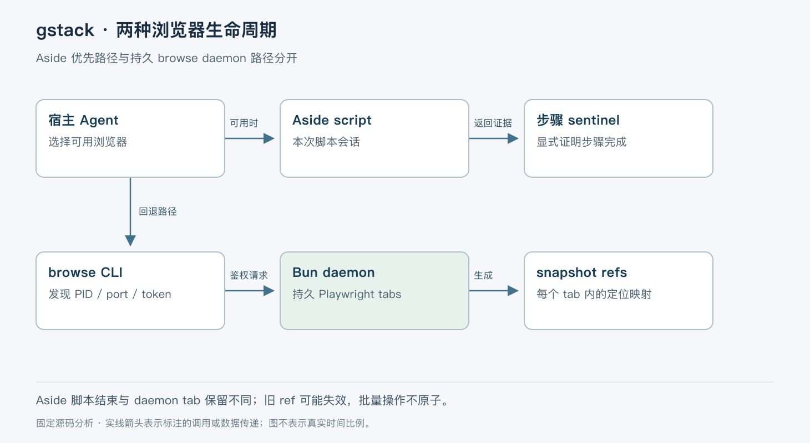

# gstack 的浏览器执行与状态边界

> 版本依据：仓库 [garrytan/gstack](https://github.com/garrytan/gstack)；默认分支 `main`；完整 commit `2db0b3adc84b95be08d08bda4f9799ca7fa8665e`。源码读取日期：2026-10-05（Asia/Shanghai）。榜单快照：2026-10-04 23:56。

本文面向有工程经验的开发者。实现事实以这一源码快照为准；“本文归纳”是分析判断，“说明性示例”未实际执行。许可证以仓库 [LICENSE](https://github.com/garrytan/gstack/blob/2db0b3adc84b95be08d08bda4f9799ca7fa8665e/LICENSE) 为依据。没有提供额外参考文档。


gstack 将工程工作流技能与浏览器执行能力组合，支持 Agent 在计划、审查、QA 和发布准备中取得实际页面证据。只依靠源码和模型推断，容易漏掉交互、登录状态和布局问题；但每次操作都新启浏览器，又会丢失会话并增加等待。

本快照版本为 `1.91.19`、MIT 许可。本文聚焦浏览器路径，因为它包含项目与普通技能库最不同的运行时机制；其他技能不因此被解释为同一个自治 Agent 内核。架构文档中的启动时间和命令延迟是作者描述，本次未做性能复测。[包定义](https://github.com/garrytan/gstack/blob/2db0b3adc84b95be08d08bda4f9799ca7fa8665e/package.json)、[架构说明](https://github.com/garrytan/gstack/blob/2db0b3adc84b95be08d08bda4f9799ca7fa8665e/ARCHITECTURE.md)。

## 两种浏览器具有不同生命周期

当前架构优先探测 Aside；可用时使用用户已有浏览器，否则回退到项目自带的浏览器 daemon。Aside 路径由 `scripts/resolvers/aside.ts` 生成技能中的操作协议，要求一次脚本完成一个完整流程；每次 `repl` 是新的会话，不能依赖上次脚本变量。协议还要求成功 sentinel，避免把恒为 0 的进程退出码当作业务成功。[Aside 探测与协议](https://github.com/garrytan/gstack/blob/2db0b3adc84b95be08d08bda4f9799ca7fa8665e/scripts/resolvers/aside.ts#L89-L130)。

回退路径不同：编译后的 browse CLI 经本机 HTTP 调用长期运行的 Bun 服务，服务通过 Playwright 控制 Chromium。多次命令能共享 tabs 和浏览器上下文。不能把 Aside 的单次脚本模型与 daemon 的常驻状态模型混写。[两种引擎](https://github.com/garrytan/gstack/blob/2db0b3adc84b95be08d08bda4f9799ca7fa8665e/ARCHITECTURE.md#L5-L72)。



以下说明性示例限定在 daemon：Agent 打开临时测试页，读取 accessibility snapshot，点击页面按钮，再截图验证结果。它不登录用户账号，也不代表本次实际运行。

## CLI 发现服务后发送命令

`ensureServer()` 结合状态文件、进程存活和 `/health` 决定复用还是启动。状态文件存 PID、端口、token 等服务定位信息；它不是页面状态的完整备份。服务写入使用临时文件与 rename，当前实现还为临时名加入随机值，避免多个写者争同一个 `.tmp` 文件。[服务发现](https://github.com/garrytan/gstack/blob/2db0b3adc84b95be08d08bda4f9799ca7fa8665e/browse/src/cli.ts#L791-L870)、[状态写入说明](https://github.com/garrytan/gstack/blob/2db0b3adc84b95be08d08bda4f9799ca7fa8665e/browse/src/server.ts#L618-L637)。

`sendCommand()` 优先取 `--tab-id`，其次 `BROWSE_TAB`，将 command、args 与可选 tabId 序列化，带 Bearer token 向 `127.0.0.1:<port>/command` 发 POST。普通请求超时为 30 秒，cookie 导入路径另有 90 秒设置。[客户端请求](https://github.com/garrytan/gstack/blob/2db0b3adc84b95be08d08bda4f9799ca7fa8665e/browse/src/cli.ts#L931-L952)。

服务端路由先处理访问范围，再交 `ctx.commands.handle()`。tunnel 路径有命令 allowlist，并拒绝带 `--out` 的本地文件写入请求；不是所有本地 daemon 操作都能远程调用。`/batch` 在当前路由表只注册 local surface，不能从“为远端低延迟设计”的注释推断 tunnel 同样可达。[路由与远端范围](https://github.com/garrytan/gstack/blob/2db0b3adc84b95be08d08bda4f9799ca7fa8665e/browse/src/routes/commands.ts#L1-L155)。

## snapshot 把页面元素变成可调用引用

`handleSnapshot()` 对当前 tab 或 frame 读取 `ariaSnapshot()`，解析 role/name，分配 `@e1` 等引用，并创建 Playwright Locator 存到 `TabSession`。后续 `click @e3` 解析的是 Locator 映射，不需要把特殊属性注入网页 DOM。[快照实现](https://github.com/garrytan/gstack/blob/2db0b3adc84b95be08d08bda4f9799ca7fa8665e/browse/src/snapshot.ts#L1-L130)。

`TabSession` 按 tab 保存 page、refMap、上次 snapshot 和 active frame。这样不同 tab 不共用元素引用。`resolveRef()` 找不到引用或 Locator 对应元素已消失时抛错，要求重新 snapshot。页面变化后旧编号不是持久业务 ID，不应跨重建页面盲目复用。[tab 状态与引用](https://github.com/garrytan/gstack/blob/2db0b3adc84b95be08d08bda4f9799ca7fa8665e/browse/src/tab-session.ts#L1-L112)。

同一个 role/name 的元素重排也值得注意：Locator 的匹配语义来自 Playwright，不是对 DOM 节点的永久身份承诺。关键操作前重新观察，并在操作后检查结果，才能降低页面变化导致的误操作。

## busy 与 dead 必须分开

CLI 不会因为一次 health 请求没有响应就杀掉活进程。`decideDaemonRestart()` 根据 PID 是否活着、有限健康探测是否成功和用户是否显式 force restart，选择重试同一 daemon、报告 busy 或重启已死 daemon。这个设计避免重页面阻塞被误判成崩溃，进而丢失 tabs 和登录状态。[重启决策](https://github.com/garrytan/gstack/blob/2db0b3adc84b95be08d08bda4f9799ca7fa8665e/browse/src/cli.ts#L337-L411)。

命令连接异常后，某些路径最多重试一次；这不能被理解为所有浏览器动作都天然幂等。响应丢失时，远端动作可能已经执行。cookie 导入做了更保守的特殊处理：超时或连接丢失时明确提示可能部分完成，不自动重放，要求检查目标后手工重试。[错误与重试](https://github.com/garrytan/gstack/blob/2db0b3adc84b95be08d08bda4f9799ca7fa8665e/browse/src/cli.ts#L954-L1034)。

batch 内部使用逐项 `await`，每项经过命令处理并收集独立状态。无效项或失败项不会使所有既有操作回滚；返回 HTTP 200 只是批处理响应，调用者还要检查 `failed` 和各项结果。它是减少往返的批量接口，不是事务。[batch 实现](https://github.com/garrytan/gstack/blob/2db0b3adc84b95be08d08bda4f9799ca7fa8665e/browse/src/routes/commands.ts#L52-L134)。

## 持久状态的层次与限制

daemon 存活时，页面对象与 refs 在内存中延续；磁盘状态文件让下一次 CLI 找到 daemon。`TabSession` 的 loaded HTML 为特定 context 重建保存内存副本，注释明确不写磁盘；lastSnapshot 还会作为 diff 基线保留，不能当成页面当前事实。进程重启后的完整恢复能力要看各持久化模块和具体模式，不能只凭 `.gstack/browse.json` 存在就声称会话无损。[状态区分](https://github.com/garrytan/gstack/blob/2db0b3adc84b95be08d08bda4f9799ca7fa8665e/browse/src/tab-session.ts#L28-L61)。

工程上，常驻浏览器减少重复启动并保留上下文，代价是生命周期、并发 tab、认证与恢复更复杂。CLI 与 daemon 的网络边界也增加“动作已执行但响应未收到”的不确定窗口。相比纯技能文本，这是需要真实运行验证的部分。

## 采用条件与源码阅读地图

适合已有编程 Agent、希望把浏览器证据纳入 QA 的团队。若只需要无状态截图，长期 daemon 的复杂性未必必要；如果需要多人共同控制同一浏览器，应进一步审查 scoped token、tab 归属和具体共享策略，不能只共用根 token。

建议阅读 `scripts/resolvers/aside.ts` 确定分流，再读 `browse/src/cli.ts:ensureServer/sendCommand`、`routes/commands.ts`、`snapshot.ts:handleSnapshot` 与 `tab-session.ts:resolveRef`。对照 `test/aside-driver.test.ts` 与 `browse` 相关测试，分别检查技能协议和实际命令实现，避免只读架构图就判断所有恢复行为。

最小验证推荐自带 daemon 与本地无副作用 HTML。以下命令根据 package scripts 整理，未在本次环境运行；前置条件为 Bun 1.4+、该快照锁文件依赖及 Playwright Chromium：

```bash
bun run browse/src/cli.ts goto http://127.0.0.1:8080/
bun run browse/src/cli.ts snapshot -i
```

先由用户准备临时页面服务，再使用实际 snapshot 返回的引用点击，不要照抄示例 `@e3`。验证点是 daemon PID 是否复用、不同 tab 的 refs 是否隔离、元素删除后旧引用是否报错，以及服务忙时是否保留进程。本次没有启动浏览器或读取用户登录态。

gstack 的浏览器部分最值得借鉴的是对操作上下文的持续维护，同时在错误处理中保留“进程忙”和“进程死”的区别。常驻状态带来的便利，必须与可观察的失败语义一起评估。
