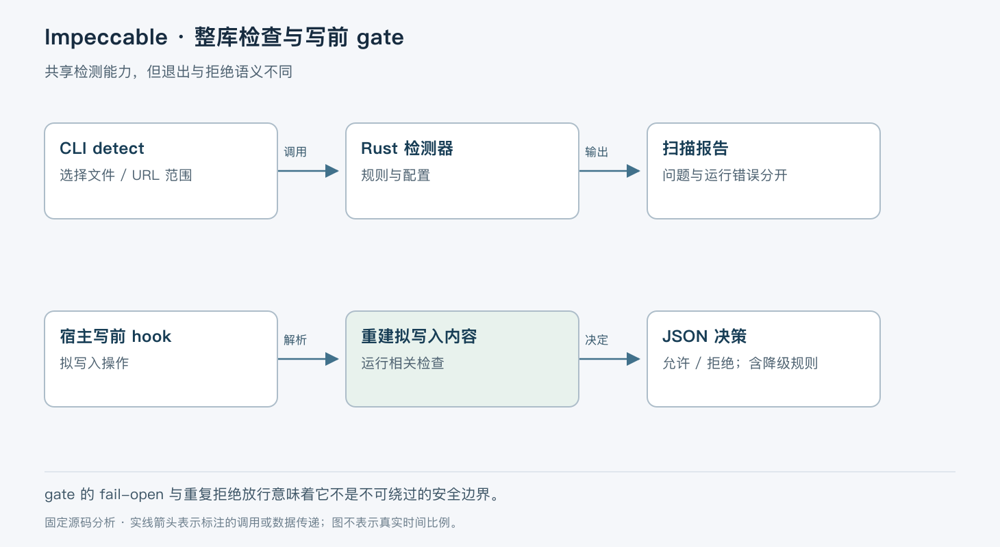

# Impeccable 的设计指导与确定性检查

> 版本依据：仓库 [pbakaus/impeccable](https://github.com/pbakaus/impeccable)；默认分支 `main`；完整 commit `6e802bd0ed99f53180e2359fddab6da8d97970d9`。源码读取日期：2026-10-05（Asia/Shanghai）。榜单快照：2026-10-04 23:56。

本文面向有工程经验的开发者。实现事实以这一源码快照为准；“本文归纳”是分析判断，“说明性示例”未实际执行。许可证以仓库 [LICENSE](https://github.com/pbakaus/impeccable/blob/6e802bd0ed99f53180e2359fddab6da8d97970d9/LICENSE) 为依据。没有提供额外参考文档。


Impeccable 将设计工作方法与可执行检测组合起来。它针对的是 AI 前端输出容易重复模板、忽略既有设计约定的问题：只给一段审美提示，难以稳定检查所有改动；只用规则检测，又无法决定产品应该采用什么视觉方向。

当前源码已包含 Rust 引擎、npm 启动 shim、技能、宿主 hooks 和浏览器相关实现，不能沿用“纯提示词合集”的旧印象。npm 包为 `4.1.0`，平台引擎依赖固定为 `0.1.11`，两者版本号不同。项目采用 Apache-2.0 许可；检测规则无需模型与 API key 是官方说明，不等于浏览器运行或 Agent 设计迭代没有其他依赖。[项目定位](https://github.com/pbakaus/impeccable/blob/6e802bd0ed99f53180e2359fddab6da8d97970d9/README.md#L1-L25)、[包与引擎版本](https://github.com/pbakaus/impeccable/blob/6e802bd0ed99f53180e2359fddab6da8d97970d9/package.json)。

## 产品事实与视觉系统分开维护

`init` 流程维护 `PRODUCT.md`，记录产品受众、任务、运行场景、已确认事实与约束；它不生成视觉世界，也不写 `DESIGN.md`。现有视觉系统由 document 流程记录，新视觉工作另走对应流程。这样能避免把某次界面风格选择误写成永恒的产品事实。[初始化协议](https://github.com/pbakaus/impeccable/blob/6e802bd0ed99f53180e2359fddab6da8d97970d9/skill/reference/init.md#L1-L60)。

这仍属于 Agent 工作指令：宿主读取后由模型执行探索、询问和文件编辑。确定性 detector 则是另一条代码路径，针对文件或渲染页面运行规则。本文重点追踪 detect 与写前 hook，live variants 的完整生命周期未在本次深入验证，不把它与本地检测混成一个统一循环。



## npm 入口如何找到真实引擎

`cli/bin/cli.js` 先查 `IMPECCABLE_BIN`，再查平台 optional dependency，接着查固定引擎版本的用户缓存，最后尝试下载二进制。远端下载必须取得 SHA-256 sidecar 且哈希匹配才写入缓存；写入用带 PID 的临时文件再 rename，下载失败不会把未验证文件放到正式缓存。[启动 shim](https://github.com/pbakaus/impeccable/blob/6e802bd0ed99f53180e2359fddab6da8d97970d9/cli/bin/cli.js#L1-L67)。

`--version` 由 shim 自己返回 npm 包版本，不启动引擎。真正命令以 `spawnSync()` 交给二进制，并透传退出状态；无法找到或启动引擎时用 127。排查“同一版本行为不同”时应记录 npm 版本、引擎版本及是否使用了环境变量覆盖，不能只看一行 `--version`。[版本与进程入口](https://github.com/pbakaus/impeccable/blob/6e802bd0ed99f53180e2359fddab6da8d97970d9/cli/bin/cli.js#L69-L100)。

## 一次 detect 如何区分问题与扫描失败

说明性示例：Agent 修改了落地页，开发者运行 `impeccable detect --json src/`。Rust `run_detect()` 进入 `detect_cli()`，解析 scope 和配置选项，读取项目配置，选择目标并收集 Findings。非 HTML 文件使用文本模式，HTML 与 URL 有相应引擎；输入类型不同，能获得的上下文也不同。[CLI 合同](https://github.com/pbakaus/impeccable/blob/6e802bd0ed99f53180e2359fddab6da8d97970d9/crates/detect/src/cli.rs#L23-L85)、[解析入口](https://github.com/pbakaus/impeccable/blob/6e802bd0ed99f53180e2359fddab6da8d97970d9/crates/detect/src/cli.rs#L390-L437)。

结果汇总后，先应用项目过滤与 scope，再按 primary/advisory 分类。退出码有明确语义：完整扫描且无 primary 为 0，有 primary 为 2，至少一个目标无法扫描为 1。部分目标扫描成功并发现问题，不能抵消另一个目标失败；操作失败优先。[汇总与退出](https://github.com/pbakaus/impeccable/blob/6e802bd0ed99f53180e2359fddab6da8d97970d9/crates/detect/src/cli.rs#L588-L634)。

这决定了 CI 集成方式：JSON 数组为空并不自动意味着成功，必须同时检查退出码。advisory 可以显示，但不应阻塞自动化。默认尊重项目配置、文件忽略和 inline ignore；`--no-config` 等开关改变的是检测上下文，应记录在比较结果时使用的条件中。

多个 URL 会尝试共用浏览器检测会话。初始化失败时标记 operational failure，跳过对应 URL 并关闭共享资源；完成扫描后同样关闭。这里的资源复用不能被写成“所有目标并行检测”，源码中仍有有序目标处理。[共享浏览器生命周期](https://github.com/pbakaus/impeccable/blob/6e802bd0ed99f53180e2359fddab6da8d97970d9/crates/detect/src/cli.rs#L545-L586)。

## 写前 gate 先重建拟写入内容

Cursor 的 `hook-before-edit` 接收宿主工具事件。它从 `file_path` 等字段定位文件，并尝试取得完整拟写内容；对于片段编辑，会读取旧文件，按 old/new 片段重建修改后的文本。缺少原文、旧片段未匹配或只有不完整片段时，不能可靠检测，因此进入 skipped 路径。[内容投影](https://github.com/pbakaus/impeccable/blob/6e802bd0ed99f53180e2359fddab6da8d97970d9/crates/hook/src/before_edit.rs#L38-L161)。

随后检查扩展名、生成路径、live preview 标记、项目启用状态、native 平台与忽略规则。单次扫描字节上限为 1 MiB；超限选择跳过。检测器异常也允许继续，这个 gate 明确偏向防止开发流程被卡死，不能拿来当安全策略强制执行器。[适用范围与退化](https://github.com/pbakaus/impeccable/blob/6e802bd0ed99f53180e2359fddab6da8d97970d9/crates/hook/src/before_edit.rs#L751-L848)。

有阻断级 Findings 时，它按会话、文件和 finding signature 累计拒绝次数，把信息写进缓存。相同问题重复超过阈值后，返回允许并附上警告，避免模型反复提交同一个修改而陷入循环。返回进程码始终为 0，真正许可在 JSON 的 `permission` 字段里；只检查 Shell 退出码会误解拒绝结果。[重复拒绝与输出](https://github.com/pbakaus/impeccable/blob/6e802bd0ed99f53180e2359fddab6da8d97970d9/crates/hook/src/before_edit.rs#L849-L918)。

这条链路的状态包括当前文件、拟修改文本、检测 Findings 和拒绝计数。它不把拟写入文件与宿主最终写入操作包成一个事务；如果文件在检测后又被别的进程改变，不能据此保证最终落盘文本与被检查文本完全一致。

## 检测范围与设计判断的取舍

确定性规则容易重跑与定位，但只能覆盖已编码的模式。`PRODUCT.md` 和设计系统上下文让判断更贴近项目，代价是这些文件需要维护；豁免规则减少误报，也可能隐藏应当复查的问题。写前反馈缩短修改循环，重复拒绝后放行则明确放弃了“所有问题必须修好才允许写入”的强保证。

适合已有前端工程、需要 Agent 设计方法和静态反馈协同的团队。不适合把无 Findings 当成 UX、可访问性或视觉质量全面合格。涉及交互、真实设备和用户理解的结论，仍需浏览器检查与人工评估。本次没有测量规则准确率或误报率。

## 阅读地图与最小验证

建议按 `cli/bin/cli.js` → `crates/detect/src/cli.rs` → `crates/detect/src/detect_text.rs` → `crates/hook/src/before_edit.rs` 阅读，分别确认引擎来源、扫描合同、规则输入和宿主反馈。规则兼容性证据可查看 `tests/oracle/golden/`；shim 下载与错误分支可看 `tests/cli-shim.test.mjs`。Golden 文件记录预期，不代表本次重新跑过测试。

最小路径先扫描已有静态文件，不安装 hooks。以下命令依据官方 CLI 整理，未在本次环境运行；前提是已审阅并安装与本快照匹配的引擎，且路径指向本快照 shim：

```bash
node cli/bin/cli.js --version
node cli/bin/cli.js detect --json tests/fixtures/antipatterns/hook-inline-ignore.html
node cli/bin/cli.js detect --json --no-inline-ignores tests/fixtures/antipatterns/hook-inline-ignore.html
```

后两条可能在缺少引擎时下载二进制，所以本次没有执行。预期两种忽略策略能解释 Findings 差异，同时检查退出码。然后人为指定不存在的文件，验证它返回扫描失败而不是“零问题”。接入 hook 则应在宿主信任后单独验证 JSON 许可协议。

Impeccable 的价值在于让可编码规则参与设计迭代，同时保留产品和审美判断的独立位置。采用时应保持这种分工，不让检测器的确定性掩盖设计结论的不确定性。
