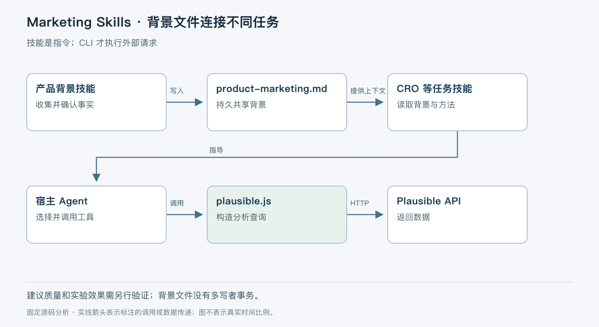

# Marketing Skills 的上下文复用机制

> 版本依据：仓库 [coreyhaines31/marketingskills](https://github.com/coreyhaines31/marketingskills)；默认分支 `main`；完整 commit `dda3841f0b294e01e93b1541486beefbfab0915e`。源码读取日期：2026-10-05（Asia/Shanghai）。榜单快照：2026-10-04 23:56。

本文面向有工程经验的开发者。实现事实以这一源码快照为准；“本文归纳”是分析判断，“说明性示例”未实际执行。许可证以仓库 [LICENSE](https://github.com/coreyhaines31/marketingskills/blob/dda3841f0b294e01e93b1541486beefbfab0915e/LICENSE) 为依据。没有提供额外参考文档。


Marketing Skills 把营销任务的分析步骤、交付约定和工具入口封装为 Agent 技能。它主要解决重复解释产品背景、分析顺序不稳定、建议缺少验证假设的问题。直接给模型一句“优化落地页”往往缺少目标客户、流量来源和转化定义；这里的核心是先建立共享产品背景，再按具体任务加载方法。

仓库采用 MIT 许可。它有技能正文、参考材料、独立服务 CLI 与回归测试，没有一个统一托管所有营销任务的运行服务。外部服务账号、模型、工具权限和发布流程由使用者或宿主提供。README 所说的自动激活是宿主按技能描述选择能力，不是仓库内置的确定性分类器。[目录与安装说明](https://github.com/coreyhaines31/marketingskills/blob/dda3841f0b294e01e93b1541486beefbfab0915e/README.md)、[技能校验脚本](https://github.com/coreyhaines31/marketingskills/blob/dda3841f0b294e01e93b1541486beefbfab0915e/validate-skills.sh)。

## 共享背景文件是任务之间的连接点

`product-marketing` 技能维护 `.agents/product-marketing.md`，把产品定位、受众、竞争关系、客户语言、证据和目标组织成可被后续任务读取的文件。它还识别 `.claude/product-marketing.md` 及旧文件名，建议迁移到规范位置。迁移是给宿主执行的工作流程，不是加载时自动运行的数据库 migration。[背景技能](https://github.com/coreyhaines31/marketingskills/blob/dda3841f0b294e01e93b1541486beefbfab0915e/skills/product-marketing/SKILL.md#L1-L44)。

`cro` 技能先读取该背景，然后识别页面类型、主要转化目标和流量背景。正文才进入价值主张、标题、CTA、信任证据及摩擦点的分析。这里“按影响顺序分析”是一项专家工作法，没有源码实现转化率预测器，也没有基于线上流量自动计算这些维度的权重。[CRO 入口](https://github.com/coreyhaines31/marketingskills/blob/dda3841f0b294e01e93b1541486beefbfab0915e/skills/cro/SKILL.md#L1-L32)。



本文将其归纳为“共享背景、任务方法、可选数据工具”三层。图中的外部 API 调用只有在 Agent 选择并执行相应 CLI 后才发生；读到技能正文不会自动查询或修改营销系统。

## 从落地页问题到可验证的建议

说明性示例：某团队请 Agent 分析预约演示页面，目标是增加合格预约，而不是所有表单提交。一次合理的执行顺序如下。

首先，宿主根据 `cro` 的描述加载正文。Agent 读取产品背景，如果文件已写清目标客群和销售周期，就不必再次询问。缺少的流量来源、当前转化定义仍需补齐。输入网页 URL 本身不足以证明页面有问题，更不能说明问题来自按钮颜色。

其次，Agent 按方法读取页面与已有证据。`cro` 的输出分为容易实施的改动、需优先投入的改动、待 A/B 测试的假设以及文案备选。这里最重要的区分是“建议”和“已证实的增长”：技能要求生成测试想法，不会因为输出了分析就证明转化率提高。[分析与输出约定](https://github.com/coreyhaines31/marketingskills/blob/dda3841f0b294e01e93b1541486beefbfab0915e/skills/cro/SKILL.md#L34-L133)。

如果产品背景本身缺失，`product-marketing` 可以从 README、页面文案和配置拟定初稿，再交用户修正。后续实质性保存要更新文档版本和 Changelog。这条记录帮助理解“受众定义为何改变”，但文档中的版本号是文本约定，不是并发控制令牌；两个 Agent 同时编辑仍需要宿主或 Git 解决冲突。[初稿流程](https://github.com/coreyhaines31/marketingskills/blob/dda3841f0b294e01e93b1541486beefbfab0915e/skills/product-marketing/SKILL.md#L23-L61)、[背景文档模板与更新规则](https://github.com/coreyhaines31/marketingskills/blob/dda3841f0b294e01e93b1541486beefbfab0915e/skills/product-marketing/SKILL.md)。

## 数据查询由独立 CLI 完成

以 `tools/clis/plausible.js` 为具体源码链路。进程从 argv 读取命令，从 `PLAUSIBLE_API_KEY` 读取凭据，从 `PLAUSIBLE_BASE_URL` 选择服务地址。`parseArgs()` 只处理长选项和值；`main()` 根据 `stats aggregate`、`stats pages` 等子命令组装请求。统计查询转为 `POST /api/v2/query`，把站点、指标、日期范围和可选维度放进 JSON。[参数与请求入口](https://github.com/coreyhaines31/marketingskills/blob/dda3841f0b294e01e93b1541486beefbfab0915e/tools/clis/plausible.js#L1-L120)。

`statsDateRange()` 接受预设字符串，或解析由两个非空字符串组成的 JSON 数组。数组元素类型和长度不正确时，在 HTTP 请求之前抛错。这是请求合同校验；它不验证业务上所需的时区与统计口径，更不能证明传入字符串一定是合法日期。对应测试用 mock fetch 检查请求体、默认值、无效范围及 dry-run 行为。[日期范围实现](https://github.com/coreyhaines31/marketingskills/blob/dda3841f0b294e01e93b1541486beefbfab0915e/tools/clis/plausible.js#L57-L68)、[请求合同测试](https://github.com/coreyhaines31/marketingskills/blob/dda3841f0b294e01e93b1541486beefbfab0915e/tests/clis/plausible-dates.test.cjs)。

`api()` 在 `--dry-run` 下返回请求预览并隐藏 Authorization；正常路径调用 `fetch()`，再尝试把响应解析为 JSON，失败时返回状态码与原始文本。值得注意的是，这个函数没有以 `res.ok` 统一拒绝 HTTP 错误，也没有配置重试或请求超时。因此调用方需要检查响应内容，不能只把“CLI 输出了 JSON”当成成功。这个结论仅针对已读的 Plausible adapter，不能不经检查推广到所有 CLI。[HTTP 包装层](https://github.com/coreyhaines31/marketingskills/blob/dda3841f0b294e01e93b1541486beefbfab0915e/tools/clis/plausible.js#L12-L31)。

## 持久化、失败和重复操作的边界

技能自身不维护任务队列。宿主中断后，已写入的产品背景可以重读；尚未落盘的分析与外部操作是否完成，要从宿主记录和远端状态确认。共享背景的版本记录提供人工可追踪性，却没有锁、事务或自动合并机制。

Plausible 的统计请求主要读取数据，但该仓库还提供其他服务的操作入口。不能因为它们都位于 `tools/clis/` 就假定都无副作用。真正的写操作是否幂等，应逐一核对远端 API 与 adapter；技能的叙述性流程没有统一提供幂等键或回滚补偿。

`validate-skills.sh` 检查目录名与 frontmatter 名称是否一致、描述长度、命名格式及触发描述等。它解决的是可发现性和包装一致性，不验证分析结论是否有商业效果。[结构校验](https://github.com/coreyhaines31/marketingskills/blob/dda3841f0b294e01e93b1541486beefbfab0915e/validate-skills.sh#L20-L106)。测试目录里的 CLI 合同测试又属于另一层：验证输入如何变成请求，不代表真实服务可达、账号有权限或实验取得显著结果。

## 取舍与采用条件

| 机制 | 收益 | 使用者仍需补足 |
| --- | --- | --- |
| Markdown 共享背景 | 能跨任务复用并做 Git 审查 | 更新责任人、冲突处理和事实核验 |
| 任务专用技能 | 分析流程比临时提示更稳定 | 宿主的技能发现与模型执行能力 |
| 独立服务 CLI | 调用合同可测试，可按需组合 | 凭据、权限、限流、错误处理 |
| 分离建议与实验 | 避免把文案意见当成增长事实 | 实验设计、样本量与线上测量 |

适合让营销、产品和工程共同维护产品事实，并已有明确转化指标的团队。不适合期望安装后即可自动增长、自动发布和自动归因的场景。缺少业务数据时仍可生成初步建议，但其证据等级应明确降低。

## 从哪读起，如何最小验证

按 `product-marketing/SKILL.md` → `cro/SKILL.md` → `tools/clis/plausible.js` → `tests/clis/plausible-dates.test.cjs` 的顺序阅读，分别回答背景如何产生、任务如何读取背景、请求怎样构造、合同怎样验证。

推荐先验证请求预览，避免一开始连接真实营销账号。以下命令依据源码整理，未在本次环境运行；前置条件是支持内置 `fetch` 的 Node，工作目录为本固定快照。即使 dry-run，脚本仍先检查 API key，因此用一个仅供本地预览的占位值：

```bash
PLAUSIBLE_API_KEY=test-only-key node tools/clis/plausible.js stats aggregate \
  --site-id example.com --date-range '["2026-09-01","2026-09-30"]' --dry-run
node --test tests/clis/plausible-dates.test.cjs
```

预期预览中的 `body.date_range` 是数组，Authorization 为 `***`，不调用远端接口。真实接入后另行验证服务返回、统计口径和权限。本次实际完成的是静态源码与测试阅读，没有请求真实统计数据。

这个项目的可复用价值落在背景与工作方法的组织上。采用时把“背景事实由谁维护”和“建议如何验证”确定下来，比一次安装多少技能更有意义。
