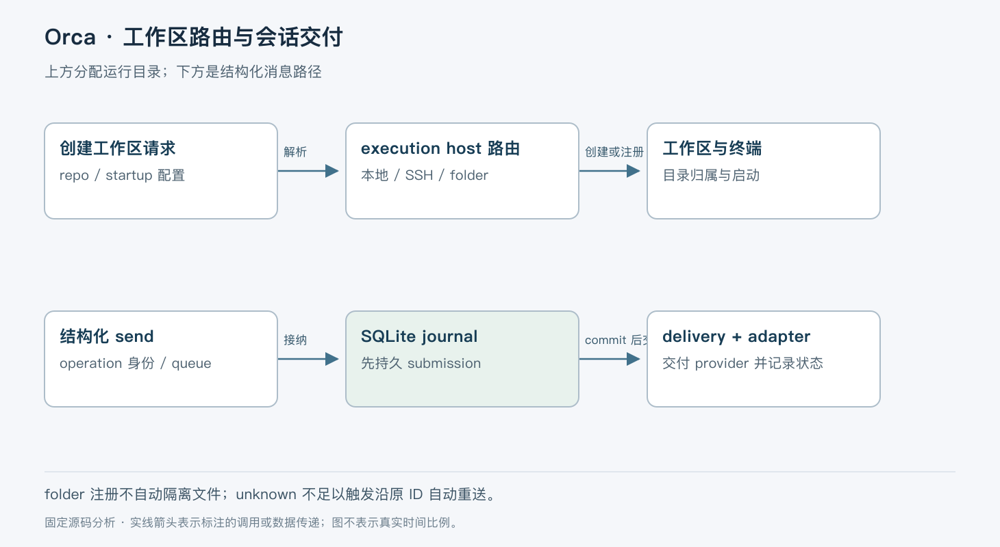

# Orca：以工作区和持久会话管理并行编码 Agent

> 版本依据：仓库 [stablyai/orca](https://github.com/stablyai/orca)；默认分支 `main`；完整 commit `ea6a6d60774ac2b74bb6692d1798e3ab13b99ae0`。源码读取日期：2026-10-05（Asia/Shanghai）。榜单快照：2026-10-04 23:56。Orca 为用户额外指定项目，不在本次榜单中。

本文面向有工程经验的开发者。实现事实以这一源码快照为准；“本文归纳”是分析判断，“说明性示例”未实际执行。许可证以仓库 [LICENSE](https://github.com/stablyai/orca/blob/ea6a6d60774ac2b74bb6692d1798e3ab13b99ae0/LICENSE) 为依据。没有提供额外参考文档。

## 一、定位与本篇范围

Orca 是围绕编码 Agent 的桌面工作环境，集成工作区、终端、结构化聊天、评审和远程入口。模型推理与实际编码仍由 Codex、Claude Code 等 provider 执行；Orca 负责让多个任务在可区分的目录、进程与会话中运行。[项目定位](https://github.com/stablyai/orca/blob/ea6a6d60774ac2b74bb6692d1798e3ab13b99ae0/README.md#L15-L24)

简单地开多个终端也能并行，但容易混淆哪段输出属于哪个 checkout、重启后该恢复谁、发送失败是否需要重发。本文选择两条代表性链路：创建 managed worktree，以及结构化消息的持久接纳与交付。终端路径作为边界对照，不把两类通道混为一套协议。

仓库以 MIT 开源；README 还列有独立 cloud 工作区。本文确认的是当前桌面与本地 runtime 源码，未验证移动端、云中继和每一种操作系统组合的部署可用性，功能列表也不构成稳定性证明。[仓库说明](https://github.com/stablyai/orca/blob/ea6a6d60774ac2b74bb6692d1798e3ab13b99ae0/README.md)

## 二、整体认知：任务目录、终端与会话不是同一个对象

repo 描述项目及其执行位置；worktree 为任务提供工作目录；terminal 是 PTY 交互通道；structured session 维护可理解为消息、工具调用和回合的记录。一个工作区可以承载这些能力，但工作区 ID 不等于 provider 会话 ID。

本文按职责归纳为客户端、runtime、执行宿主和 provider 四部分。UI 或 RPC 进入 runtime，runtime 根据 repo 的执行宿主路由操作。对结构化聊天，host 管准入、会话打开、串行化与交付，adapter 处理 provider 特有协议，journal 保存可恢复的提交和事件。

图展示两条相关但独立的链路：上方分配运行目录，下方记录并交付消息。worktree 的存在本身不证明消息已经交给 provider。

## 三、创建工作区：先决定操作究竟发生在哪里

说明性示例：为“修复测试”创建一个工作区，再在其中启动编码 Agent。`createManagedWorktree` 先准备 rearm holder，通过 `trackRuntimeWorkspaceCreate` 执行创建，finally 补充被消费的预创建 checkout 池容量。这样后续复制或启动失败也不会永久耗尽一个池槽位。[创建入口](https://github.com/stablyai/orca/blob/ea6a6d60774ac2b74bb6692d1798e3ab13b99ae0/src/main/runtime/orca-runtime-create-managed-worktree.ts#L18-L33)

实际逻辑先解析 repo，检查所选 Agent 是否被禁用，再把 startupAgent 或 draft 转成有效启动配置。随后统一调用 `resolveWorktreeCreateRoute`。源码特别说明：只看旧 `connectionId` 字段会把仅带 SSH executionHostId 的 repo 错送到本地路径，从而在客户端对远端路径运行 Git。[配置与路由](https://github.com/stablyai/orca/blob/ea6a6d60774ac2b74bb6692d1798e3ab13b99ae0/src/main/runtime/orca-runtime-create-managed-worktree.ts#L40-L101)

folder repo 的“工作区创建”只是注册，并不等于创建 Git worktree；SSH 路由进入 remote 创建；不支持直接 dispatch 的 runtime host 明确报错。普通本地 Git 创建、setup 和终端启动则由拆分的协作者完成。[分支逻辑](https://github.com/stablyai/orca/blob/ea6a6d60774ac2b74bb6692d1798e3ab13b99ae0/src/main/runtime/orca-runtime-create-managed-worktree.ts#L102-L156)；[本地创建](https://github.com/stablyai/orca/blob/ea6a6d60774ac2b74bb6692d1798e3ab13b99ae0/src/main/runtime/runtime-local-worktree-create.ts)；[终端启动](https://github.com/stablyai/orca/blob/ea6a6d60774ac2b74bb6692d1798e3ab13b99ae0/src/main/runtime/runtime-local-worktree-terminal-startup.ts)

因此，并行隔离依赖实际使用独立 Git worktree。folder 注册不会自动复制目录，也不能因为 UI 中有两个条目就推定文件隔离。Git worktree 还共享仓库对象等资源，不是虚拟机或安全沙箱。

## 四、结构化发送：接纳消息后再交给 provider

`sendStructuredAgentSessionTurn` 接受 mutation envelope 与消息 body，构造 sendPlan，进入统一 mutation 路径；其中 `clientOperationId` 表达一次客户端操作身份。发送可以在 provider 正忙时以 `queue-if-active` 排队。会话写入与必须由活动 provider 完成的操作并不相同：源码明确将发送意图、Stop 和部分选项记录视为 conversation writes，而不是都要求先取得 provider writer lease。[发送入口](https://github.com/stablyai/orca/blob/ea6a6d60774ac2b74bb6692d1798e3ab13b99ae0/src/main/native-chat/agent-session-wire/structured-agent-session-host-mutations.ts#L1-L87)

`runQueueableStructuredAgentSessionSend` 先做排队决策，必要时形成 draft；否则执行 immediate 路径，接纳成功后唤醒 delivery。不要把 queued draft 与已经写入 provider 的状态混为一谈。[排队包装](https://github.com/stablyai/orca/blob/ea6a6d60774ac2b74bb6692d1798e3ab13b99ae0/src/main/native-chat/agent-session-wire/structured-agent-session-queued-send.ts)

journal 数据库使用 WAL 和 `synchronous=FULL`。源码说明选择 FULL 的原因是：提交记录必须先持久化，adapter 才能派发；仅使用 WAL 的 NORMAL 不满足相同的提交同步要求。事务回调必须保持同步，避免 await 期间混入其他聊天的数据库语句。[数据库配置](https://github.com/stablyai/orca/blob/ea6a6d60774ac2b74bb6692d1798e3ab13b99ae0/src/main/native-chat/agent-session-journal/journal-database.ts#L145-L158)；[事务契约](https://github.com/stablyai/orca/blob/ea6a6d60774ac2b74bb6692d1798e3ab13b99ae0/src/main/native-chat/agent-session-journal/journal-database.ts#L190-L214)

这属于先记意图、后做外部动作的设计，但不意味着本地 SQLite 与 provider 进程之间存在分布式事务。两者之间仍可能崩溃，需要明确表达“不知道是否送达”。

## 五、交付循环、并发与不确定结果

host delivery 建立 `StructuredAgentSessionDeliveryLoop`，向它注入按 session 串行执行、启动 provider child、fence、放弃排队项等能力。打开会话后恢复 journal、发布恢复状态，并在存在 queued submission 时唤醒循环。journal commit 触发的唤醒也排进同一 session serialize，避免循环决定停下时丢失一次唤醒。[交付接线](https://github.com/stablyai/orca/blob/ea6a6d60774ac2b74bb6692d1798e3ab13b99ae0/src/main/native-chat/agent-session-wire/structured-agent-session-host-delivery.ts#L25-L125)

最重要的异常状态是 `unknown`。它不是“等得太久”的同义词，而是某个进程事实结束了等待，却没有证明消息送达或未送达，例如 host 在确认前重启、provider 子进程退出、写入结果无法确定，或 adapter 接受后 journal 更新失败。[不确定原因定义](https://github.com/stablyai/orca/blob/ea6a6d60774ac2b74bb6692d1798e3ab13b99ae0/src/main/native-chat/agent-session-journal/journal-dispatch-doubt-reasons.ts)

源码规定不能仅凭 unknown，沿原 ID 自动再次交付。用户决定重新输入时会产生新身份；这是一次可能重复业务效果的新发送，不能伪装成安全透明重试。恢复还可能根据 provider 历史中的身份线索判断先前发送，但文本相同并不足以证明是同一次提交。相关 crash-boundary 测试覆盖 fingerprint 不一致、强客户端 ID 匹配和不可信历史边界等情况。[崩溃边界测试](https://github.com/stablyai/orca/blob/ea6a6d60774ac2b74bb6692d1798e3ab13b99ae0/src/main/native-chat/agent-session-journal/journal-crash-boundary.test.ts#L374-L461)

由此获得的能力是避免在最危险的模糊窗口盲目重复执行；代价是某些状态需要等待更可靠的证据或由用户决定。本文没有运行这些故障注入测试，引用的是测试约束与实现，不是本次稳定性实测。

## 六、重启恢复不等于终端进程复活

journal 打开时会重放状态。若发现可修复的损坏后缀，代码在事务中删除拒绝的部分并记录需重建的区间；必要时发布 repair epoch 和可见说明，避免空历史被误当成完整恢复。只读状态不会强行修复。某些重建依赖 provider 历史，不能承诺任意损坏后都无损恢复。[打开与修复](https://github.com/stablyai/orca/blob/ea6a6d60774ac2b74bb6692d1798e3ab13b99ae0/src/main/native-chat/agent-session-journal/journal-store-open.ts#L26-L90)

PTY 则有单独的 daemon 连接与恢复机制。`withDaemonRetry` 只在符合 daemon-gone 等条件时共享一次 respawn promise，再尝试操作；输入写入失败会通知相关 pane 进入不可写与恢复状态，避免后台终端持续冻结而用户毫不知情。[daemon 恢复](https://github.com/stablyai/orca/blob/ea6a6d60774ac2b74bb6692d1798e3ab13b99ae0/src/main/daemon/daemon-pty-daemon-recovery.ts#L12-L87)

这不表示重建 daemon 就能复活已经死亡的任意 shell 进程，也不表示终端原始输入拥有结构化消息相同的 operation journal。判断恢复能力时应先问当前会话走 TUI/PTY 还是结构化 provider 通道。

## 七、设计取舍与场景判断

| 机制 | 获得的能力 | 代价或边界 |
|---|---|---|
| execution host 统一路由 | 本地、SSH 操作使用明确归属 | 路由与权限状态需要持续维护 |
| 每任务独立 worktree | 并行修改可分开审阅 | 仍需处理分支整合与依赖安装 |
| 持久 submission 先于派发 | 重启后有可核对的发送意图 | 增加数据库同步开销 |
| unknown 不自动重送 | 减少不确定窗口中的重复执行 | 不能保证自动推进所有任务 |
| journal 与 PTY 分开 | 各自保留合适的协议与恢复方式 | 两种模式能力不能完全互换 |

适合同时管理多个编码任务、需要终端和结构化聊天共存、经常切换本地与 SSH 环境的开发者。不适合把 worktree 当作恶意代码隔离，也不能把桌面恢复记录当作外部命令撤销系统。自动创建目录、启动 Agent 和后续命令仍需使用者管理权限范围。

## 八、源码阅读地图

| 顺序 | 源码入口 | 应回答的问题 |
|---|---|---|
| 1 | [createManagedWorktree](https://github.com/stablyai/orca/blob/ea6a6d60774ac2b74bb6692d1798e3ab13b99ae0/src/main/runtime/orca-runtime-create-managed-worktree.ts) | repo 怎样决定真正的执行位置？ |
| 2 | [host mutations](https://github.com/stablyai/orca/blob/ea6a6d60774ac2b74bb6692d1798e3ab13b99ae0/src/main/native-chat/agent-session-wire/structured-agent-session-host-mutations.ts) | 意图写入与 provider 写入有什么不同？ |
| 3 | [host delivery](https://github.com/stablyai/orca/blob/ea6a6d60774ac2b74bb6692d1798e3ab13b99ae0/src/main/native-chat/agent-session-wire/structured-agent-session-host-delivery.ts) | commit 怎样可靠唤醒交付？ |
| 4 | [journal database](https://github.com/stablyai/orca/blob/ea6a6d60774ac2b74bb6692d1798e3ab13b99ae0/src/main/native-chat/agent-session-journal/journal-database.ts) | 哪个提交必须先落盘？ |
| 5 | [dispatch doubt](https://github.com/stablyai/orca/blob/ea6a6d60774ac2b74bb6692d1798e3ab13b99ae0/src/main/native-chat/agent-session-journal/journal-dispatch-doubt-reasons.ts) | 哪些事实只能推出 unknown？ |
| 6 | [journal-store-open](https://github.com/stablyai/orca/blob/ea6a6d60774ac2b74bb6692d1798e3ab13b99ae0/src/main/native-chat/agent-session-journal/journal-store-open.ts) | 损坏被怎样披露，何时需要重建？ |

## 九、最小上手与验证

推荐在临时 Git 仓库中使用官方桌面发行版，安装入口见固定 [README](https://github.com/stablyai/orca/blob/ea6a6d60774ac2b74bb6692d1798e3ab13b99ae0/README.md)。发行包未必对应本文 commit；精确复现源码时，应使用该 commit 与仓库构建说明。先安装并认证一个支持的 provider，再添加本地仓库、创建独立 worktree，发送只读请求。

以下是依据源码机制设计的验证步骤，未在本次环境执行：确认新任务 cwd 位于新 worktree；确认原 checkout 未被修改；若使用结构化会话，观察发送接纳与 provider 开始的不同状态；关闭并重开客户端，检查会话历史与工作区关联。最后在专门的测试环境模拟 provider 在确认前退出，核对是否出现不确定状态，且没有无提示重发。普通 UI 重启不能替代这一故障实验。

本次没有安装 Orca、启动 provider、运行 SSH 或移动端，也没有测量恢复延迟。文中图表由固定源码关系归纳，是真实实现的机制图，不是产品截图。

## 结语

Orca 的工程选择是把任务目录、交互进程和消息交付各自建模。尤其在发送结果不确定时，保留“不知道”并阻止盲目重送，比让界面看起来始终顺畅更能保护用户的实际工作。
