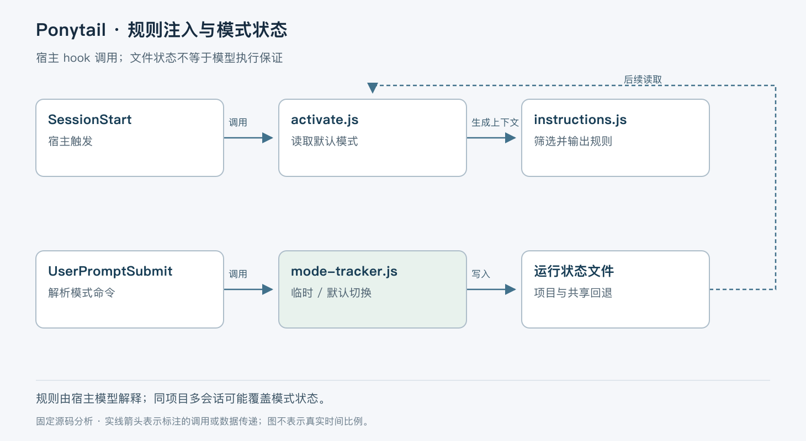

# Ponytail 如何约束编程 Agent

> 版本依据：仓库 [DietrichGebert/ponytail](https://github.com/DietrichGebert/ponytail)；默认分支 `main`；完整 commit `c982cd411abb53323c4baa1baa3c2f020b8d0b08`。源码读取日期：2026-10-05（Asia/Shanghai）。榜单快照：2026-10-04 23:56。

本文面向有工程经验的开发者。实现事实以这一源码快照为准；“本文归纳”是分析判断，“说明性示例”未实际执行。许可证以仓库 [LICENSE](https://github.com/DietrichGebert/ponytail/blob/c982cd411abb53323c4baa1baa3c2f020b8d0b08/LICENSE) 为依据。没有提供额外参考文档。


Ponytail 把“先复用，再考虑新代码”的开发习惯写进 Agent 上下文，并通过宿主生命周期 hook 维持当前模式。它解决的是模型容易过度实现的问题：明明已有标准库或平台控件，却新建一套组件和抽象。它没有接管编译器、代码审查或权限系统，不能从“模式已激活”推出生成结果一定更简单、更安全。

本快照采用 MIT 许可，`package.json` 版本为 `4.10.3`。项目包含技能正文、不同宿主的适配入口、生命周期脚本和测试。README 的节省代码、成本和时间数字来自作者特定模型与任务集的测量，不能外推为所有 Agent 的收益。本次没有复现该基准。[包定义](https://github.com/DietrichGebert/ponytail/blob/c982cd411abb53323c4baa1baa3c2f020b8d0b08/package.json)、[作者基准与限制](https://github.com/DietrichGebert/ponytail/blob/c982cd411abb53323c4baa1baa3c2f020b8d0b08/benchmarks/results/2026-06-18-agentic.md)。

## 规则正文与运行状态分开保存

本文按职责归纳为三部分：`skills/ponytail/SKILL.md` 定义行为，`ponytail-instructions.js` 按强度组装上下文，`ponytail-runtime.js` 适配宿主输出并保存模式。执行任务的模型、工具和文件权限仍属于 Claude Code、Codex 等宿主。

“阶梯”先要求理解真实代码链路，再检查需求是否必要、仓库是否已有实现、标准库与原生平台是否够用，最后才写最小实现。这是一组影响模型选择的指令，没有 AST 变换器替开发者自动删除抽象。规则也明确保留信任边界校验、防止数据丢失的错误处理、安全和可访问性。少写代码不意味着少处理这些条件。[技能正文](https://github.com/DietrichGebert/ponytail/blob/c982cd411abb53323c4baa1baa3c2f020b8d0b08/skills/ponytail/SKILL.md)、[上下文构造](https://github.com/DietrichGebert/ponytail/blob/c982cd411abb53323c4baa1baa3c2f020b8d0b08/hooks/ponytail-instructions.js#L11-L105)。



图中实线表示 hook 调用或写入，虚线表示向宿主提供上下文。文件里的模式与模型已经读到的指令是两个状态：文件变了，并不能追溯撤回已经进入对话的内容。

## 一次启动如何激活规则

以“在设置页加入日期输入”为说明性示例。会话启动时，宿主按 hook manifest 调用 `ponytail-activate.js`；脚本读取 `getDefaultMode()`，若为 `off`，清除模式标记并提前返回。否则调用 `setMode()`，再用 `getPonytailInstructions(mode)` 生成本轮要注入的文字。[事件注册](https://github.com/DietrichGebert/ponytail/blob/c982cd411abb53323c4baa1baa3c2f020b8d0b08/hooks/claude-codex-hooks.json)、[激活入口](https://github.com/DietrichGebert/ponytail/blob/c982cd411abb53323c4baa1baa3c2f020b8d0b08/hooks/ponytail-activate.js#L25-L64)。

构造器读取技能文件，去掉 frontmatter，并按模式过滤强度表格和带引号的示例。普通规则会保留，防止把恰好以 `Full:` 开头的正文错当成模式示例删掉。读取文件失败时，返回内置 fallback 规则，而不是中止会话。这个兜底提高了插件容错性，也意味着发布时要注意正文与 fallback 是否同步。[过滤器与 fallback](https://github.com/DietrichGebert/ponytail/blob/c982cd411abb53323c4baa1baa3c2f020b8d0b08/hooks/ponytail-instructions.js)。

随后 `writeHookOutput()` 根据宿主决定 JSON 形状。Codex 使用 `hookSpecificOutput.additionalContext`；Cursor 使用 `additional_context`；原生 Claude 的 SessionStart 可以输出纯文本，而 SubagentStart 要使用 JSON。适配的关键是遵守事件协议，不能把同一段 stdout 随意发给所有宿主。[输出适配](https://github.com/DietrichGebert/ponytail/blob/c982cd411abb53323c4baa1baa3c2f020b8d0b08/hooks/ponytail-runtime.js#L105-L174)。

模型收到规则后，可能选择已有日期控件或原生 `<input type="date">`。这是说明性推演，具体选择必须满足需求；Ponytail 不会实际检查该控件是否符合业务的日历、时区和可访问性要求。

## 模式切换不是会话恢复系统

`UserPromptSubmit` 把 stdin JSON 中的 `prompt` 规范化，再识别 `/ponytail lite|full|ultra|off`。普通模式切换写 live mode；只有 `/ponytail default <mode>` 调用 `writeDefaultMode()` 写持久配置。`/ponytail-review` 被明确排除在持久会话模式之外，避免一次审查命令把整段会话永久切入 review。[切换链路](https://github.com/DietrichGebert/ponytail/blob/c982cd411abb53323c4baa1baa3c2f020b8d0b08/hooks/ponytail-mode-tracker.js#L22-L116)、[默认配置写入](https://github.com/DietrichGebert/ponytail/blob/c982cd411abb53323c4baa1baa3c2f020b8d0b08/hooks/ponytail-config.js#L136-L150)。

这一区分决定重启行为：新会话依据默认配置重新激活，不能把上一次的临时模式当作完整会话 checkpoint。Ponytail 没有保存模型内部推理、任务进度或工具操作账本。

`setMode()` 同步写入两个可能的路径：按 `CLAUDE_PROJECT_DIR` 派生的项目模式文件，以及共享 `.ponytail-active` 标记。不同项目可以隔离 live mode；同一项目的多个会话仍共用状态，共享状态栏标记也按最后一次写入覆盖。路径派生用字符替换而不是哈希，因此也不宜把它描述成严格无碰撞的租户标识。[状态存储](https://github.com/DietrichGebert/ponytail/blob/c982cd411abb53323c4baa1baa3c2f020b8d0b08/hooks/ponytail-runtime.js#L41-L83)。

文件写入没有跨文件事务：项目标记写成功而共享标记失败，或进程在两次写入之间退出，可能使显示与项目读取不一致。激活脚本把标记写入当作 best-effort，失败后仍可能注入规则。它选择不阻塞用户会话，代价是状态栏不能作为规则生效的强证明。

## 宿主冲突和输入异常如何处理

Cursor 的 always-on 规则是一个明确冲突案例。若检测到 `.cursor/rules/ponytail.mdc`，hook 不再注入另一份规则，也不声称能通过 `off` 关闭它，而是输出说明。这体现了文件规则与生命周期 hook 的不同控制范围；多根工作区的检测又只覆盖第一个根，代码注释明确记录了限制。[Cursor 规则检测](https://github.com/DietrichGebert/ponytail/blob/c982cd411abb53323c4baa1baa3c2f020b8d0b08/hooks/ponytail-runtime.js#L85-L103)。

输入 JSON 错误会落入静默失败路径。stdin 正常结束时执行一次 `finish()`；如果输入流一直不结束，1 秒定时器处理已到达内容并退出，外层 hook manifest 另有 5 秒超时。`done` 标记避免同一进程内重复处理。它防的是挂住宿主，不提供跨进程 exactly-once，也不保证异常输入一定切换成功。[输入与退出控制](https://github.com/DietrichGebert/ponytail/blob/c982cd411abb53323c4baa1baa3c2f020b8d0b08/hooks/ponytail-mode-tracker.js#L145-L179)。

## 工程收益与适用条件

| 机制 | 得到的能力 | 成本或边界 |
| --- | --- | --- |
| 行为阶梯注入 | 在生成前提醒模型复用已有能力 | 依赖模型遵循，仍需代码审查 |
| 强度过滤 | 同一规则源支持不同约束程度 | 解析依赖正文约定，格式变化要测试 |
| 宿主专用输出 | 同一技能适配不同生命周期协议 | 宿主升级可能改变上下文注入效果 |
| best-effort 标记 | 插件故障不轻易阻断正常会话 | 显示状态与实际上下文可能不一致 |

适合已有测试与审查流程、想减少过度设计的团队。不适合拿来替代安全策略、静态检查或性能预算。需要严格审计的场景应把“最大改动范围”“依赖新增审批”等要求落入可执行检查，而不能只写在技能正文里。

## 源码阅读与最小验证

建议从事件注册进入，依次阅读以下入口。

| 阅读目标 | 入口 | 要回答的问题 |
| --- | --- | --- |
| 哪些事件加载规则 | `hooks/claude-codex-hooks.json` | 启动、子 Agent 与用户输入分别触发什么？ |
| 规则如何裁剪 | `hooks/ponytail-instructions.js` | 哪些行随强度改变，哪些必须保留？ |
| 状态归属 | `hooks/ponytail-runtime.js` | 两个会话是否共享模式文件？ |
| 切换边界 | `hooks/ponytail-mode-tracker.js` | 临时切换与 default 有何不同？ |
| 回归覆盖 | `tests/hooks.test.js`、`tests/cursor-hooks.test.js` | 测试是否覆盖目标宿主与规则冲突？ |

推荐先在隔离的临时 HOME 和测试仓库验证 hook，再装入日常宿主。依据官方脚本与测试入口整理，以下命令未在本次环境运行：

```bash
npm test
```

前置条件是与本快照匹配的 Node/npm 环境，并检查根脚本还会进入 `pi-extension` 与 `ponytail-mcp`。预期应看到模式过滤、宿主输出与命令行为测试结果；通过测试不等于模型已在真实任务中减少代码。实际接入后应分别测试默认启动、临时切换、重启恢复默认值，以及两个同项目会话交错切换，记录真实差异。

Ponytail 最值得借鉴的是把行为指导和宿主适配分离。采用时也应保留这条边界：插件负责把规则送到模型面前，团队仍负责判断改动是否正确。
