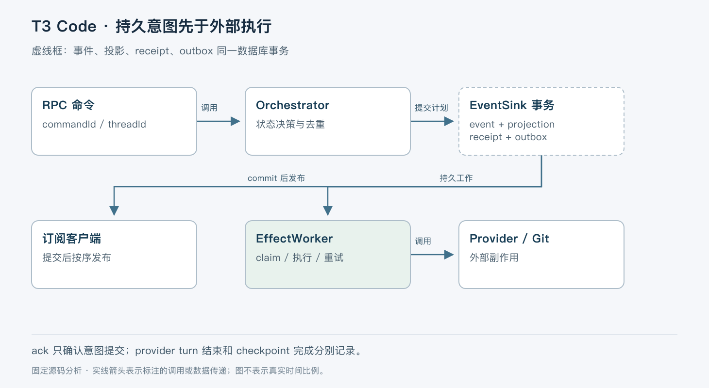

# T3 Code：把 Agent 控制台做成可恢复的命令与事件系统

> 版本依据：仓库 [pingdotgg/t3code](https://github.com/pingdotgg/t3code)；默认分支 `main`；完整 commit `4ee6bfd50ef4a089440d5c3662db2298da9cc50e`。源码读取日期：2026-10-05（Asia/Shanghai）。榜单快照：2026-10-04 23:56。

本文面向有工程经验的开发者。实现事实以这一源码快照为准；“本文归纳”是分析判断，“说明性示例”未实际执行。许可证以仓库 [LICENSE](https://github.com/pingdotgg/t3code/blob/4ee6bfd50ef4a089440d5c3662db2298da9cc50e/LICENSE) 为依据。没有提供额外参考文档。


## 一、定位：控制已有 Agent 的工作环境

T3 Code 是运行在工作环境旁边的 Agent 控制服务，Web、桌面和移动客户端通过它操作已有编码 Agent。它不替代 provider 自己的推理循环、账号或认证；README 要求先安装并登录所用 provider。官方仍将项目描述为早期，预期存在缺陷。[定位与前置条件](https://github.com/pingdotgg/t3code/blob/4ee6bfd50ef4a089440d5c3662db2298da9cc50e/README.md#L1-L26)

它要解决的不只是聊天界面问题。客户端会断线，不同设备可能同时操作，provider 进程可能退出，Git checkpoint 也可能晚于模型回答完成。若仅把界面按钮直接映射为进程调用，就很难说明重试是否重复执行、页面状态是否已经持久化。

当前 v2 实现将命令意图、领域事件、查询投影和外部副作用拆开。这是本文的主线，不据此把仓库所有功能都归为一个通用 Agent Loop。

## 二、整体认知：环境拥有文件与进程

服务端环境拥有项目文件、Git、终端和 provider 进程；客户端拥有 UI 和平台能力。共享连接与领域状态位于 `packages/client-runtime`，避免 Web 与移动端各自实现重连逻辑。客户端不能拿自己的路径或认证替代远端环境的状态。[官方架构说明](https://github.com/pingdotgg/t3code/blob/4ee6bfd50ef4a089440d5c3662db2298da9cc50e/docs/internals/overview.md#L1-L19)

本文按职责归纳：RPC 接收命令，Orchestrator 决定领域变化，EventSink 负责原子提交，EffectWorker 执行已经记录的副作用，ProviderAdapter 隔离不同 provider 协议。投影是给查询和界面使用的状态，而 event log 是编排状态的事实来源。



图中虚线框是一个数据库事务，不包含模型调用或 Git 操作。ack 表示意图提交，不能直接显示成“Agent 已完成”。

## 三、一次消息如何被接受

说明性示例：用户在手机上给某线程发送“检查测试失败原因”，随后连接断开并重试。`ThreadMessageIntake.dispatchCommand` 对 `message.dispatch` 处理附件声明与路径重映射，再交给线程管理。若明确属于提交前拒绝，释放本次复制的附件；若错误可能发生在提交后，则保留，避免把已接受消息引用的文件删掉。[消息入口](https://github.com/pingdotgg/t3code/blob/4ee6bfd50ef4a089440d5c3662db2298da9cc50e/apps/server/src/orchestration-v2/ThreadMessageIntake.ts#L12-L29)；[附件处理](https://github.com/pingdotgg/t3code/blob/4ee6bfd50ef4a089440d5c3662db2298da9cc50e/apps/server/src/orchestration-v2/ThreadMessageIntake.ts#L130-L173)

Orchestrator 先查 `commandId` 的 receipt。已拒绝的命令返回原拒绝；已经接受的命令读取原事件和序号。它检查 receipt 所属线程，防止一个线程的命令 ID 被用来冒充另一个线程的成功请求。这里不要把 `commandId` 当作可随意复用的业务字段，也不要推导出代码验证了请求体所有字段相同：当前这段复用逻辑重点检查线程归属。[receipt 分支](https://github.com/pingdotgg/t3code/blob/4ee6bfd50ef4a089440d5c3662db2298da9cc50e/apps/server/src/orchestration-v2/Orchestrator.ts#L9681-L9741)

新命令经过状态决策产生事件和 effects。`EventSink.commitCommand` 在事务内预约 receipt、追加事件、更新投影、写入 effect outbox，再更新结果序号。事务失败时不会只留下领先于事件的持久投影。[提交实现](https://github.com/pingdotgg/t3code/blob/4ee6bfd50ef4a089440d5c3662db2298da9cc50e/apps/server/src/orchestration-v2/EventSink.ts#L517-L565)

这解决的是编排命令的持久接纳与重试问题，不是外部模型服务的端到端 exactly-once。客户端若在不确定时换一个新 commandId 重发，仍可能表达第二个独立意图。

## 四、事件提交以后，怎样避免通知乱序

数据库提交按顺序完成，不意味着异步代码按同一顺序广播。早提交的任务可能在广播前被调度器暂停，后提交的任务先通知客户端；如果客户端按最大 sequence 去重，早事件可能被丢弃。

EventSink 用 `publishLane` 将“事务末尾占据发布通道”与“提交后发布”连起来，直到发布结束才释放。实际外部 I/O 仍不进入决策事务。这个很具体的顺序约束比笼统地说“采用事件驱动”更能解释系统行为。[发布通道](https://github.com/pingdotgg/t3code/blob/4ee6bfd50ef4a089440d5c3662db2298da9cc50e/apps/server/src/orchestration-v2/EventSink.ts#L229-L263)

订阅与快照也有类似边界。`subscribeBeforeSnapshot` 在同一个 mutex 保护下读取快照并建立订阅；无 mutex 的变体则先订阅再读取快照。不能仅凭函数名字断言两个变体执行顺序相同。其目的都是避免快照与后续变化之间漏掉更新。[订阅工具](https://github.com/pingdotgg/t3code/blob/4ee6bfd50ef4a089440d5c3662db2298da9cc50e/apps/server/src/utils/subscribeBeforeSnapshot.ts)

## 五、副作用如何执行、失败与恢复

EffectWorker 从 durable outbox claim 工作，根据类型调用 provider turn、session、checkpoint rollback 或 finalization 等服务。worker 有并发配置，失败按 attemptCount 决定重试，并使用有上限的指数延迟。执行前还会复查取消状态，处理 claim 后发生取消的竞争。[worker](https://github.com/pingdotgg/t3code/blob/4ee6bfd50ef4a089440d5c3662db2298da9cc50e/apps/server/src/orchestration-v2/EffectWorker.ts#L600-L708)

不是所有错误都应重试。纯 interrupt 遇到 provider 已不活跃可以视为不可重试控制失败；同一判断不能套用到复合 restart，因为 restart 还包括 detach 和重新启动，吞掉启动失败会丢失工作。[控制错误分类](https://github.com/pingdotgg/t3code/blob/4ee6bfd50ef4a089440d5c3662db2298da9cc50e/apps/server/src/orchestration-v2/EffectWorker.ts#L38-L66)

服务重启后，绑定已失去 provider 进程的 effects 不能无脑回放。官方架构明确要求先退役相关旧工作，再允许新任务；具体处理由 runtime recovery 与 session transition 服务负责。[恢复入口](https://github.com/pingdotgg/t3code/blob/4ee6bfd50ef4a089440d5c3662db2298da9cc50e/apps/server/src/orchestration-v2/ProviderRuntimeRecoveryService.ts)；[架构约束](https://github.com/pingdotgg/t3code/blob/4ee6bfd50ef4a089440d5c3662db2298da9cc50e/docs/internals/overview.md#L48-L67)

这意味着“任务持久化了”与“外部执行能恢复到同一指令位置”是不同承诺。本次未实际杀进程验证各种 provider 的恢复，不能声称所有 provider 对中断、重启与回滚具有一致能力。

## 六、回答完成与工作区恢复是两条链路

provider turn 结束和 run 的后续 finalization 分开记录。晚到的 checkpoint 或 diff 不应延长 provider 运行时间，也不应让界面一直显示模型仍在运行。checkpoint 使用隐藏 Git refs 保存工作区状态，不向用户分支直接添加普通提交。[完成与 checkpoint 说明](https://github.com/pingdotgg/t3code/blob/4ee6bfd50ef4a089440d5c3662db2298da9cc50e/docs/internals/overview.md#L69-L83)；[CheckpointStore](https://github.com/pingdotgg/t3code/blob/4ee6bfd50ef4a089440d5c3662db2298da9cc50e/apps/server/src/checkpointing/CheckpointStore.ts)

回退不只是恢复文件，还涉及 provider 对话。若 provider 无法回滚会话，应在改动文件前拒绝。另一个限制是共享 checkout：checkpoint 覆盖整个工作区，若其他线程也使用该目录，恢复可能覆盖别人的修改。

`isCheckpointRestoreIsolated` 解析 realpath，检查线程 worktree 与 checkpoint cwd，并扫描其他线程、归档线程、checkpoint scopes 和仍相关的 provider session 路径。隔离检查在命令准入及真正回滚前都做，防止等待期间工作区变成共享。[隔离保护](https://github.com/pingdotgg/t3code/blob/4ee6bfd50ef4a089440d5c3662db2298da9cc50e/apps/server/src/orchestration-v2/CheckpointRestoreSafety.ts)

## 七、取舍与适用边界

| 机制 | 带来的能力 | 代价或条件 |
|---|---|---|
| 事件、投影、receipt、outbox 同事务 | 断线后可解释命令是否被接纳 | 事件 schema 升级必须兼容历史 |
| provider adapter | 客户端处理统一领域对象 | provider 能力差异仍需显式表达 |
| 提交后执行 effects | 数据库事务不等待模型或 Git | 接纳与完成之间存在异步状态 |
| 隔离 worktree 才恢复文件 | 降低覆盖其他线程工作的风险 | 共享目录无法获得同样回退能力 |

适合希望从多个设备管理本机或远端编码 Agent、并需要持续状态与恢复控制的团队或个人。不适合把它当作无需安装 provider 的模型 API 服务，也不能因统一 UI 就假定各 provider 具备相同历史恢复语义。

## 八、源码阅读地图与最小验证

建议先读 [架构边界](https://github.com/pingdotgg/t3code/blob/4ee6bfd50ef4a089440d5c3662db2298da9cc50e/docs/internals/overview.md)，再按 [ThreadMessageIntake](https://github.com/pingdotgg/t3code/blob/4ee6bfd50ef4a089440d5c3662db2298da9cc50e/apps/server/src/orchestration-v2/ThreadMessageIntake.ts) → [Orchestrator](https://github.com/pingdotgg/t3code/blob/4ee6bfd50ef4a089440d5c3662db2298da9cc50e/apps/server/src/orchestration-v2/Orchestrator.ts) → [EventSink](https://github.com/pingdotgg/t3code/blob/4ee6bfd50ef4a089440d5c3662db2298da9cc50e/apps/server/src/orchestration-v2/EventSink.ts) → [EffectWorker](https://github.com/pingdotgg/t3code/blob/4ee6bfd50ef4a089440d5c3662db2298da9cc50e/apps/server/src/orchestration-v2/EffectWorker.ts) 追踪一条消息。最后读 [CheckpointRestoreSafety 测试](https://github.com/pingdotgg/t3code/blob/4ee6bfd50ef4a089440d5c3662db2298da9cc50e/apps/server/src/orchestration-v2/CheckpointRestoreSafety.test.ts)，核对共享目录为何被拒绝。相关测试仅作源码证据，本次未运行。

最小路径是先配置并认证一个 provider，再依据固定源码的 [安装说明](https://github.com/pingdotgg/t3code/blob/4ee6bfd50ef4a089440d5c3662db2298da9cc50e/docs/user/install.md) 安装与启动本地服务。README 给出的试用入口如下，未在本次环境运行；`latest` 不是本文固定 commit，执行前须核对实际版本：

```bash
npx t3@latest
```

在独立测试仓库创建线程，只发只读请求；观察 accepted 状态、provider 执行状态和最终结果。随后断开客户端再连接，检查相同线程历史是否恢复。进一步验证应在测试框架内复用同一 commandId，检查没有新增第二份领域事件，而不是重复点击发送按钮。文件恢复实验必须使用隔离 worktree。

本次只做源码、相关测试文本与架构文档交叉阅读，未启动服务、登录 provider、调用模型或测试远程连通性。

## 结语

T3 Code 把编码助手控制台中的“按钮已经点下”“意图已经保存”“外部执行已经结束”分成不同事实。它的可靠性设计主要建立在这些事实的顺序与恢复边界上。
