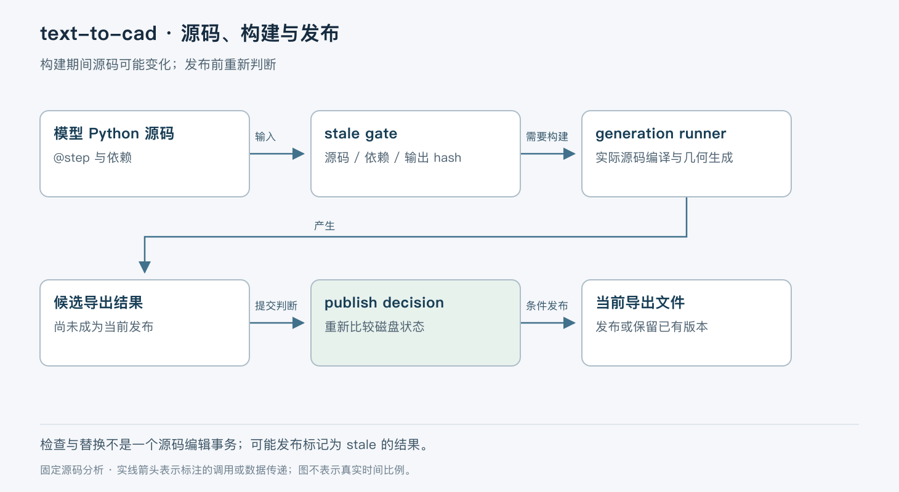

# text-to-cad 的模型构建与失效判断

> 版本依据：仓库 [earthtojake/text-to-cad](https://github.com/earthtojake/text-to-cad)；默认分支 `main`；完整 commit `8d795f56343edce7ef6b9413e02f7a92318f8229`。源码读取日期：2026-10-05（Asia/Shanghai）。榜单快照：2026-10-04 23:56。

本文面向有工程经验的开发者。实现事实以这一源码快照为准；“本文归纳”是分析判断，“说明性示例”未实际执行。许可证以仓库 [LICENSE](https://github.com/earthtojake/text-to-cad/blob/8d795f56343edce7ef6b9413e02f7a92318f8229/LICENSE) 为依据。没有提供额外参考文档。


text-to-cad 把 Agent 编写的参数化模型源码连接到可检查的 CAD 文件与本地查看器。它的独特问题是：模型文件改了、子零件改了或导出文件被手工替换后，怎样知道屏幕上的几何仍对应当前源码？仅让模型生成一段 build123d 脚本，无法解决输出过期、装配引用和并发构建覆盖的问题。

仓库包含技能、`cadgen` Python 运行时、客户端及查看器相关包。本文重点分析 CAD 模型声明、失效检查和结果发布，不把其他机器人描述与制造技能混入同一链路。本快照 `cadgen` 为 `0.7.11`、MIT 许可、Python 3.11+，包元数据标记 Beta。[定位](https://github.com/earthtojake/text-to-cad/blob/8d795f56343edce7ef6b9413e02f7a92318f8229/README.md)、[包依赖](https://github.com/earthtojake/text-to-cad/blob/8d795f56343edce7ef6b9413e02f7a92318f8229/packages/cadgen/pyproject.toml#L1-L75)。

## 模型源码、几何对象与导出文件不同步存在

技能规定以普通 Python 脚本作为可维护源，使用无参数 decorated function 返回 build123d shape。`@step(out=...)` 声明导出位置、网格容差及附属运动或材质信息；几何本身仍来自函数返回值。装饰器参数不替模型创造正确的实体结构。[模型合同](https://github.com/earthtojake/text-to-cad/blob/8d795f56343edce7ef6b9413e02f7a92318f8229/skills/cad/SKILL.md#L51-L115)、[`step()` 声明](https://github.com/earthtojake/text-to-cad/blob/8d795f56343edce7ef6b9413e02f7a92318f8229/packages/cadgen/src/cadgen/authoring.py#L607-L641)。

说明性示例是一块宽 40 mm 的安装板。Agent 维护 `src/bracket.py`，函数返回 `bd.Box(40, 20, 6)`，STEP 写到声明路径。CLI 路径相对工作目录，装饰器 `out` 相对模型脚本，这个区别直接影响文件会落在哪里。修改尺寸时应改源码再构建，不能只改查看器中的显示状态。



本文把状态归纳为源码闭包、模型 record、内容寻址 tree/objects 和具名输出。record 记录依赖和输出摘要，tree 描述结果结构，STEP/STL 等是用户交付物。它们关联，但任何一个文件存在都不足以证明整体当前有效。

## stale 判断比比较时间戳更严格

`store/gate.py` 的 `stale(model)` 是统一检查入口，根模型和子模型都走同一逻辑。它读取 record，并逐项检查以下条件。[失效检查](https://github.com/earthtojake/text-to-cad/blob/8d795f56343edce7ef6b9413e02f7a92318f8229/packages/cadgen/src/cadgen/store/gate.py#L155-L267)。

| 条件 | 检查的状态 | 安装板示例中的触发 |
| --- | --- | --- |
| 缺少 record | 是否有上次构建记录 | 首次执行 |
| 源码闭包改变 | 文件或切片哈希、引用常量值 | 宽度从 40 改为 45 |
| 子模型失效或 tree 改变 | 递归检查并比较 pinned tree | 装配中的螺栓模型更新 |
| 结果结构缺失 | tree 及组成内容是否完整 | 缓存对象被删除 |
| 输出不符 | 文件 SHA-256 与记录是否一致 | 用户手工覆盖 STEP |

闭包会记录执行所涉及的文件；切片文件可先比较整文件哈希，变化后再按已记录名字重新切片。常量值还有单独比较路径，避免将所有变化都粗糙等同为“整棵装配必须重建”。递归使用 memo，既减少重复检查，也在遍历中防止循环无限递归。这是实现机制，不表示任意循环模型都具有正确的几何语义。

技能禁止几何依赖未跟踪的时间、随机值、环境变量和工作目录。原因来自这一缓存合同：判断依据是已记录输入，隐式依赖没有变化记录就可能被误认为当前有效。[输入约束](https://github.com/earthtojake/text-to-cad/blob/8d795f56343edce7ef6b9413e02f7a92318f8229/skills/cad/SKILL.md#L96-L112)。

## 构建读取的是本次实际编译的源码

`_load_generator_module()` 读取当前源码字节，直接 `compile()`，而不是依靠 `.pyc` 的秒级时间戳和大小验证。然后在执行模块前记录本次编译缓冲，防止文件在初始化期间变化后把新源码哈希错误关联到旧几何。[模块加载](https://github.com/earthtojake/text-to-cad/blob/8d795f56343edce7ef6b9413e02f7a92318f8229/packages/cadgen/src/cadgen/_internal/generation_runner.py#L83-L133)。

同一长寿命进程可能先后加载多个 CAD 项目，而项目都可能把公共模块叫 `lib`。实现通过导入根排序和模块缓存处理避免串用其他项目的模块；`_MODULE_LOAD_LOCK` 保护同进程内共享的 `sys.path` 与 `sys.modules` 操作。它不等价于给同一模型的全部构建加全局锁。

构建执行处还有 broker job slot，围绕实际生成与输出持有，失败发布 `failed` 事件并重新抛出异常；成功后再次检查 stale，提示“构建完成时已经过期”的情形。因此 `done` 与“当前源码最新结果”仍应分开看。[执行与完成后检查](https://github.com/earthtojake/text-to-cad/blob/8d795f56343edce7ef6b9413e02f7a92318f8229/packages/cadgen/src/cadgen/_internal/generation.py#L1254-L1298)。

## 并发结果如何避免覆盖当前版本

`store/publish.py` 明确采用发布时判断，而不是同模型串行锁。两个构建可以同时运行，发布前重新计算磁盘源码闭包并与实际运行的闭包比较。[发布决策](https://github.com/earthtojake/text-to-cad/blob/8d795f56343edce7ef6b9413e02f7a92318f8229/packages/cadgen/src/cadgen/store/publish.py#L1-L49)。

如果源码未变，就允许发布。如果本次结果已过期，而磁盘 record 已经对应当前源码，只保留内容寻址对象，跳过 record 与具名输出；如果磁盘结果也过期，则仍允许发布。这意味着系统优先保护已有当前结果，并不是绝对禁止所有 stale 结果落盘。

说明性竞态是：构建 A 运行宽 40 的源码，随后用户改成 45，构建 B 更快完成。A 最后到达发布点时发现 B 的当前 record，就不应覆盖 B 的具名结果。源码同时承认检查与 rename 不是一个原子 compare-and-swap，极窄窗口仍可能落入旧结果；下一次 gate 会识别失效。不能将此包装为严格线性一致性保证。

父模型也会 pin 子模型 tree。父构建运行期间子模型更新，不会悄悄把新零件混进已有几何；完成后父模型会被识别为 stale。`test_publish_rule.py` 通过真实子进程及握手文件控制这种交错，而不是用固定 sleep 猜时序。[并发与父子快照测试](https://github.com/earthtojake/text-to-cad/blob/8d795f56343edce7ef6b9413e02f7a92318f8229/tests/python/packages/cadgen/test_publish_rule.py#L1-L130)。

## 查看器里的引用也有版本边界

像 `STEP/assembly.step#o1.2.f7` 这样的引用定位某份已保存文档中的 occurrence 与面。技能要求用 `read_scene()` 再 `scene.resolve()` 解析，数字引用属于保存时的修订；重建后应重新选择，不能默认同一编号仍指向同一面。[引用协议](https://github.com/earthtojake/text-to-cad/blob/8d795f56343edce7ef6b9413e02f7a92318f8229/skills/cad/SKILL.md#L135-L164)。

因此“把这块面加厚”必须先确认目标文件和当前选择。模型生成成功也不等于尺寸、间隙或制造条件正确；应对保存的 STEP 做测量，对 mesh-only 模型检查返回几何并查看网格，不必为了统一流程强造 STEP。

## 取舍、场景和验证

内容寻址与输入闭包让重复构建和多零件复用有依据，代价是运行时要深入处理 Python 导入、CAD 内核及输出一致性。包对 build123d 有明确上界，因为实现会依赖内部签名和拓扑行为；这类依赖升级不能只看公共 API。[依赖上界解释](https://github.com/earthtojake/text-to-cad/blob/8d795f56343edce7ef6b9413e02f7a92318f8229/packages/cadgen/pyproject.toml#L36-L53)。

适合希望用源码维护参数化零件、通过 Agent 迭代并交付可测量文件的场景。对安全关键制造、公差与材料验收，项目生成与可视化只是流程的一部分，仍需要独立工程验证。对于必须严格禁止旧结果短暂可见的服务，也需增加更强的发布协调。

源码阅读顺序：`skills/cad/SKILL.md` 读作者合同，`authoring.py:step` 看声明，`generation_runner.py:_load_generator_module` 看真实输入，`store/gate.py:stale` 看有效性，`store/publish.py:decide` 看竞态，最后读 `test_publish_rule.py`。

推荐先做单个长方体，验证“源 → 文件 → 测量 → 改源 → 重建”。以下命令按该快照技能整理并改用 uv 管理环境，未在本次环境运行：

```bash
uv venv .venv
uv pip install --python .venv/bin/python -r skills/cad/requirements.txt
uv run --no-project --python .venv/bin/python src/bracket.py
```

先按前述合同创建 `src/bracket.py`。预期输出声明的 STEP；再用 `read_scene`/`read_step` 检查尺寸，改变 WIDTH 后重跑，确认测量和文件均更新。浏览器快照还需要相应依赖与 Chromium。本次没有运行 CAD 内核或测量实体，结论限于源码与测试链路。

text-to-cad 值得研究的核心，是它认真定义了“这份几何来自哪版输入”。这比仅把自然语言转成一个可打开的模型，更接近可持续维护的 CAD 工作流。
